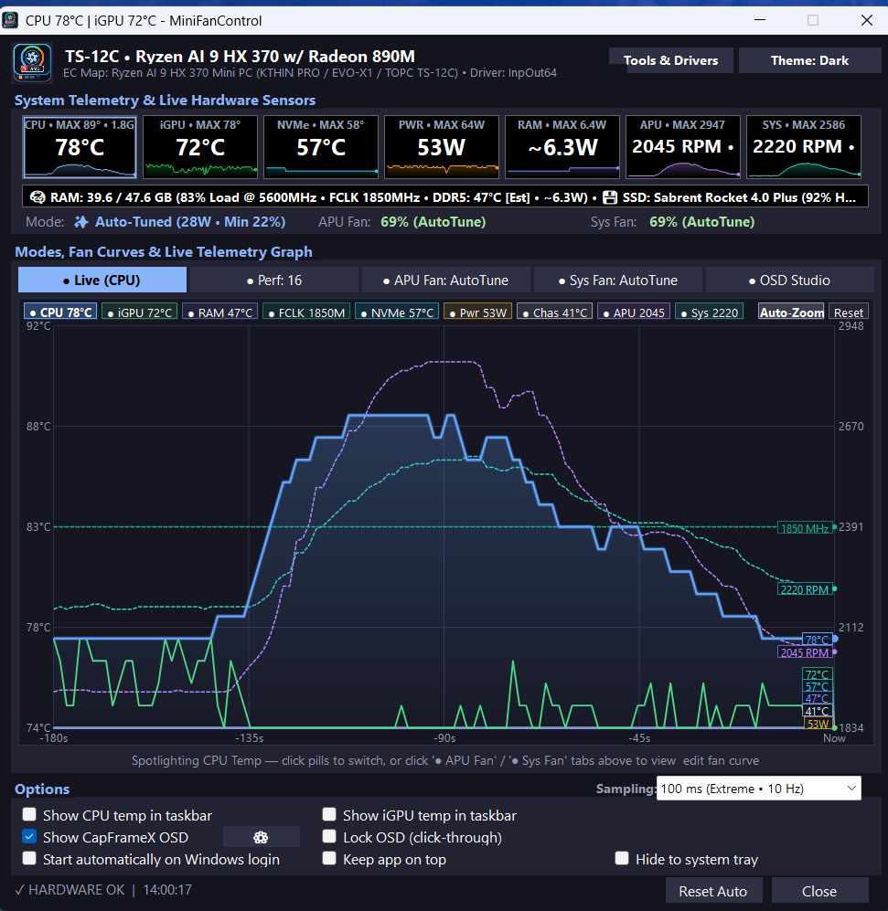
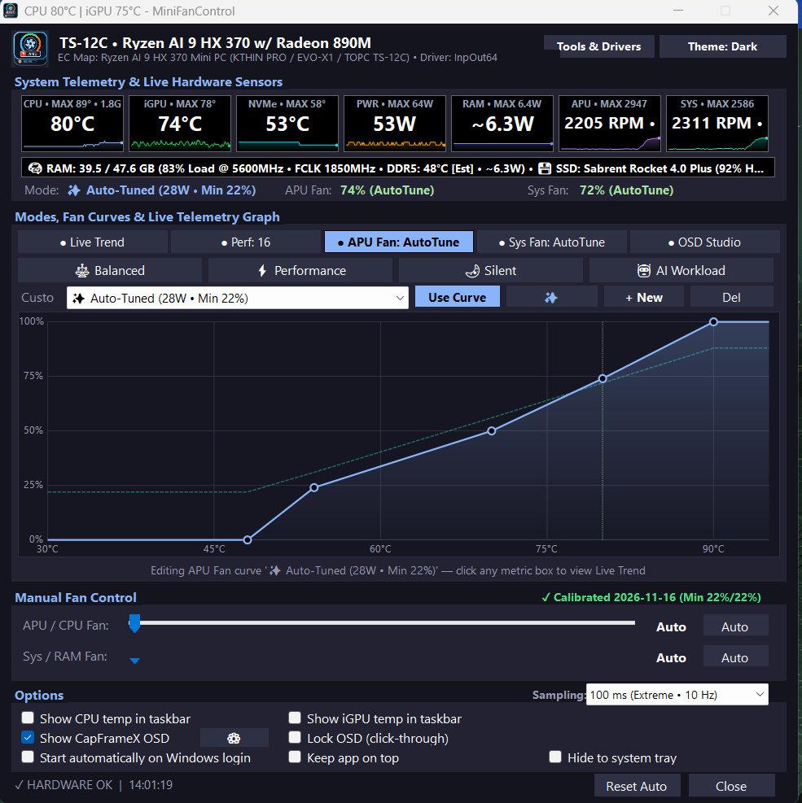
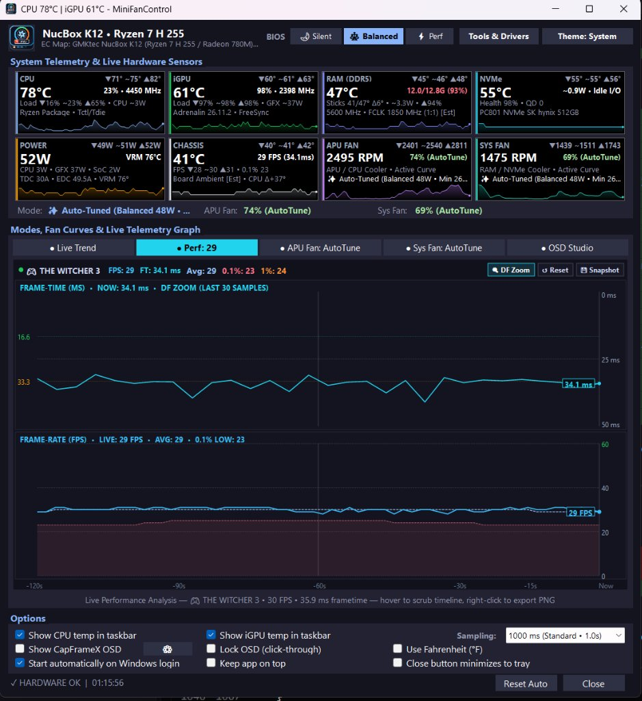
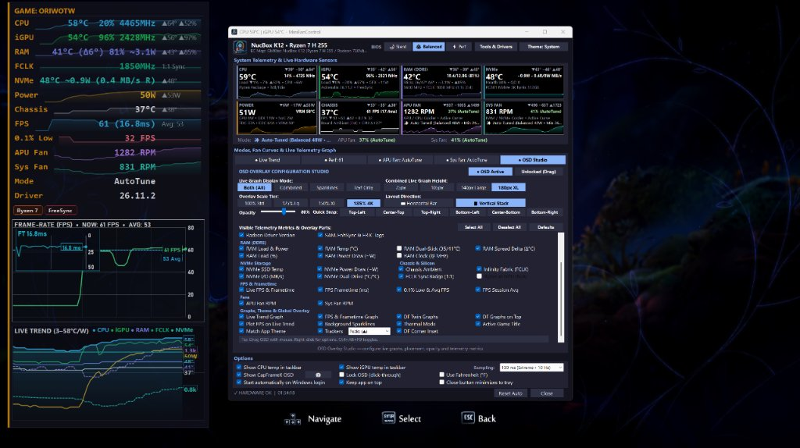
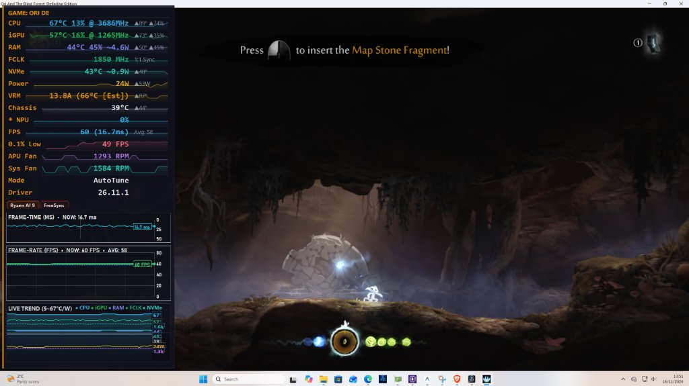

# MiniFanControl — Complete User & Hardware Tuning Guide

Welcome to the comprehensive user guide and hardware tuning reference for **MiniFanControl**. This guide walks you through every feature of the application, from initial driver installation to custom fan curve design, OSD overlay configuration, multi-monitor gaming setups, fan calibration, and multi-tool EC synchronization.

---

## Table of Contents

1. [Introduction & Architectural Overview](#1-introduction--architectural-overview)
2. [Installation & First-Time Setup](#2-installation--first-time-setup)
   - [Driver Setup (`inpoutx64.dll`)](#driver-setup-inpoutx64dll)
   - [Windows 11 Core Isolation / Memory Integrity](#windows-11-core-isolation--memory-integrity)
   - [Portable & Zero-Dependency Design](#portable--zero-dependency-design)
3. [Interface Walkthrough](#3-interface-walkthrough)
   - [Header Bar & Hardware Identification](#header-bar--hardware-identification)
   - [The High-Density Telemetry Gauge Boxes & Sparklines](#the-high-density-telemetry-gauge-boxes--sparklines)
   - [Built-In Thermal Modes & Custom Fan Curves](#built-in-thermal-modes--custom-fan-curves)
   - [Combined Live Telemetry Graph & Metric Spotlighting](#combined-live-telemetry-graph--metric-spotlighting)
   - [Manual Fan Override & Fan Sliders](#manual-fan-override--fan-sliders)
   - [Options Grid & System Tray Badges](#options-grid--system-tray-badges)
4. [Fan Calibration & Motor Stall Protection](#4-fan-calibration--motor-stall-protection)
   - [Why Calibration is Essential](#why-calibration-is-essential)
   - [Running Calibration](#running-calibration)
   - [1-Fan vs 2-Fan Automatic Detection](#1-fan-vs-2-fan-automatic-detection)
5. [CapFrameX-Style OSD Overlay & OSD Studio](#5-capframex-style-osd-overlay--osd-studio)
   - [OSD Studio Tab Overview](#osd-studio-tab-overview)
   - [Display Modes (Graph, Sparklines, Text)](#display-modes-graph-sparklines-text)
   - [Scale Tiers (100% Std to 185% 4K)](#scale-tiers-100-std-to-185-4k)
   - [Layout Directions: Horizontal Bar vs. Vertical Stack](#layout-directions-horizontal-bar-vs-vertical-stack)
   - [Repositioning, Quick Snaps & Click-Through Lock](#repositioning-quick-snaps--click-through-lock)
   - [Global Keyboard Hotkeys](#global-keyboard-hotkeys)
6. [Multi-Tool Coexistence & Hardware Bus Mutexes](#6-multi-tool-coexistence--hardware-bus-mutexes)
7. [Command-Line Interface (`minifan-helper.exe`)](#7-command-line-interface-minifan-helperexe)
8. [Supporting New Ryzen Mini PCs & Hardware Probing](#8-supporting-new-ryzen-mini-pcs--hardware-probing)
9. [Offline Demo & Simulation Mode](#9-offline-demo--simulation-mode)
10. [Frequently Asked Questions (FAQ) & Troubleshooting](#10-frequently-asked-questions-faq--troubleshooting)

---

## 1. Introduction & Architectural Overview

Standard desktop fan control utilities (such as *Fan Control* or motherboard vendor suites) look for desktop Super I/O chips (e.g. Nuvoton NCT6798D or ITE IT8688E) communicating over standard LPC I/O ports. 

AMD Ryzen Mini PCs—such as the **GMKtec NucBox K12**, **K8 Plus**, **K11**, **EVO-X1**, and **Ryzen AI 9 HX 370** systems—are architected like modern laptops. They utilize an **ITE IT5570E Embedded Controller (EC)** mapped directly at physical memory space `0xFE0B0400`. Because desktop utilities cannot communicate with this proprietary EC interface, Mini PC owners were historically trapped between noisy BIOS fan profiles or fixed RPM settings.

**MiniFanControl** bridges this gap:
- Communicates directly with the Embedded Controller registers via kernel port I/O.
- Enforces hardware-safe fan curves with 4°C asymmetric cooldown hysteresis.
- Prevents motor stalling via measured physical spin-up PWM floors.
- Synchronizes with other monitoring tools (HWiNFO, CapFrameX) via the `Global\Access_EC` mutex.

```
+-------------------------------------------------------------------------------+
|                             MiniFanControl.exe                                |
|  [Header & Hardware]  [5 Gauge Boxes + Sparklines]  [Curves & Live Graph]     |
|  [OSD Studio Panel]   [Manual Fan Controls]         [System Tray / Hotkeys]   |
+-------------------------------------------------------------------------------+
         |                                                   |
         v                                                   v
+-------------------------------+                  +--------------------+
|  AMD Display Library (ADL2)   |                  |  Global\Access_EC  |
|  (atiadlxx.dll / PMLog)       |                  |  Mutex Lock        |
|  - Radeon iGPU Temperature    |                  +--------------------+
|  - APU Silicon Power (W)      |                            |
|  - Clock, Voltage, Activity   |                            v
+-------------------------------+                  +--------------------+
                                                   |   inpoutx64.sys    |
                                                   |   (Kernel Driver)  |
                                                   +--------------------+
                                                             |
                                                             v
                                                   +--------------------+
                                                   |  ITE IT5570E EC    |
                                                   |  (@ 0xFE0B0400)    |
                                                   |  - CPU Temp (0x70) |
                                                   |  - APU Fan (0x33)  |
                                                   |  - Sys Fan (0x34)  |
                                                   |  - Modes (0x31/32) |
                                                   +--------------------+
```

---

## 2. Installation & First-Time Setup

### Driver Engines: InpOut64 (Bundled) & Safe Read-Only Fallback

MiniFanControl features an enterprise-grade multi-driver abstraction in `Hardware/NativeInpOut.cs`, prioritizing secure, verified hardware access:

#### Primary Engine: Bundled InpOut64 (`inpoutx64.dll`)

1. MiniFanControl bundles Phillip Gibbons' verified InpOut64 driver (Highresolution Enterprises v1.5.0.0), SHA256 pinned: `5F27ED4D5CD58A1EE23DEEB802E09E73F3A1D884CE2135F6E827F67B171269E7`.
2. Ensure `inpoutx64.dll` resides in the same directory as `MiniFanControl.exe`.
3. **First-time launch for fan curve writing**: Right-click `MiniFanControl.exe` and select **Run as Administrator** (or install via the scheduled task option).
   - This allows `inpoutx64.dll` to initialize its kernel driver handle (`inpoutx64.sys`).
4. Subsequent launches can be run as a standard user or configured to start automatically on Windows logon.

#### Safe Read-Only Telemetry Mode (Windows 11 Memory Integrity / HVCI Default)
If Windows 11 Memory Integrity (HVCI) blocks kernel port access or if MiniFanControl is run non-elevated:
1. MiniFanControl engages **Safe Read-Only Telemetry Mode**.
2. CPU and iGPU temperatures, package power, clocks, and NVMe health continue updating natively via AMD's official WHQL driver interface (`atiadlxx.dll`) without any unsigned or blocked drivers.
3. Fan speed writes remain locked fail-closed, ensuring 100% stability.

#### PawnIO Architectural Roadmap
Full integration with the modern scriptable PawnIO kernel driver via `PawnIOLib` bytecode modules (`pawnio_open`/`load`/`execute`) is planned on the roadmap to enable certified EV-signed, HVCI-compatible fan control without vulnerable legacy driver blocklist concerns.

### 2.1 First-Time Setup & Auto-Tune Walkthrough (The Recommended 2-Step Flow)

> [!NOTE]
> The First-Time Setup Assistant automatically appears on startup only when fan motors are uncalibrated, and can be re-opened at any time via **Tools & Drivers ▾ → ✨ First-Time Setup Assistant & Auto-Tune Guide...** or by right-clicking the system tray icon.

MiniFanControl includes an interactive **First-Time Setup Assistant** that automatically pops up on initial launch if fan calibration has not yet been performed. You can also re-open it at any time by clicking **Tools & Drivers ▾ → ✨ First-Time Setup Assistant & Auto-Tune Guide...**.

```
+---------------------------------------------------------------------------------+
| ✨ MiniFanControl — First-Time Setup & Auto-Tune Assistant                      |
+---------------------------------------------------------------------------------+
|  Welcome to MiniFanControl! Follow these 2 essential steps to calibrate your    |
|  hardware and unlock whisper-quiet, anti-stall acoustic cooling.                |
|                                                                                 |
|  [ Step 1: Calibrate Fan Motors ] -> [ Step 2: Auto-Tune Curves ] -> [ Monitor ] |
+---------------------------------------------------------------------------------+
```

#### Step 1: Calibrate Fan Motors First (Essential Pre-Requisite)

**Why Calibration is Crucial**:
Brushless blower fans used in AMD Ryzen Mini PCs (e.g. TOPC TS-12C, GMKtec K12, GMKtec EVO-X1) rely on small DC motors that require a minimum electromagnetic torque to overcome internal bearing friction. If driven below this startup threshold (e.g. 10%–20% PWM), the fan blades will completely stall, but electrical current continues flowing through the motor coils without any airflow—risking silent thermal buildup.

- **Uncalibrated Baseline**: To prevent dangerous motor stalls on unknown hardware, MiniFanControl defaults to a conservative **30% PWM floor (~1400 RPM)**.
- **The 3-Pass Calibration Engine**:
  1. Click **Calibrate Fans** in the setup assistant or on the fan curve canvas.
  2. The automated engine performs 3 progressive duty-cycle sweeps across both the APU Fan and Sys Fan, detecting the exact minimum speed where tachometer pulses reliably register.
  3. A safety margin of `+2%` is added to guarantee anti-stall reliability even as bearings age.
  4. On verified hardware like the TOPC TS-12C, calibration discovers the true stall floor at **22% PWM (~750 RPM)** for the APU cooler and **24% PWM (~800 RPM)** for the DDR5/NVMe system fan.
  5. The calibration timestamp is saved in `minifancontrol.cfg`. If older than 6 months, the UI shows a gentle reminder to re-verify after dust cleaning.

#### Step 2: Auto-Tune Fan Curve Synthesis

Once your fans are calibrated, click **Synthesize Auto-Tuned Curve** (`✨ Auto-Tune`).

**How Auto-Tune Works Under the Hood**:
The synthesis engine (`Curves/CurvePoint.cs`) evaluates live system telemetry and creates an optimized 5-point fan curve tailored specifically to your hardware:
1. **Whisper-Quiet Idle Zone**: Starts at your measured calibration floor (`ApuMinSpinPct`, e.g. 22% / ~750 RPM) and extends across an anti-hunting deadband up to `clampedIdle + 2°C` (e.g. ~48°C). Small desktop temperature fluctuations will never trigger audible fan revving.
2. **Acoustic TDP Knee**: Senses the APU package power envelope (28W vs 54W TDP) and sets a gradual ramp knee (e.g. 50%–58% PWM at 66°C–70°C).
3. **High-Load & Peak Ramp**: Progresses smoothly to 74% at 80°C and 100% full-blast cooling at 90°C+ to ensure thermal throttling never occurs.
4. **Multi-Source Sys Fan Coupling**: The secondary DDR5/NVMe fan is intelligently elevated if NVMe SSD temperatures reach ≥60°C, RAM power draw reaches ≥4.0W, or NPU utilization exceeds 20%.

**Why Auto-Tune is Dramatically Better AFTER Calibration**:
| Metric | Auto-Tune WITHOUT Calibration | Auto-Tune AFTER Calibration |
| :--- | :--- | :--- |
| **Minimum PWM Floor** | 30% (Generic Safe Default) | **22% – 24% (Measured Physical Limit)** |
| **Idle RPM (TS-12C)** | ~1400 RPM (Audible Whir) | **~750 RPM (Whisper-Quiet / Silent)** |
| **Acoustic Noise Reduction** | Baseline | **>50% Noise Reduction at Idle** |
| **Anti-Stall Reliability** | Generic | **100% Verified Hardware Anti-Stall** |
| **Thermal Protection** | 90°C Emergency Tripwire | **Full 5-Point Power-Envelope Knee** |

#### Step 3: Activating Curves & Real-Time Monitoring
1. Click **Use Curve** in the curve editor to apply the newly synthesized profile to the active EC registers.
2. Check the **Show CapFrameX OSD** option to monitor your temperatures, APU power, fan RPM, and live in-game frametimes in real time.
3. To return full fan control back to the motherboard BIOS at any time, click **Reset Auto** in the main window or right-click the system tray icon and select **Reset All Fans to BIOS Auto**.

### Windows 11 Core Isolation & Safe Monitoring Fallback

MiniFanControl respects Windows 11 **Memory Integrity** (Hypervisor-Protected Code Integrity / HVCI) and Microsoft's **Vulnerable Driver Blocklist**:
- **Keep Memory Integrity Enabled**: We strongly recommend keeping Core Isolation and Memory Integrity **ENABLED**.
- **Automatic Safe Read-Only Fallback**: If Windows blocks inpoutx64.sys, MiniFanControl safely falls back to Read-Only Telemetry Monitoring Mode. APU power, silicon temperatures, GPU load, and clocks continue updating natively via AMD's official WHQL-certified driver (tiadlxx.dll / mdfendrm.sys) with zero kernel port access.
- **Checking Driver & Security Status in the GUI**:
  Click **Tools & Drivers ▾ → 🛡️ Kernel Driver & HVCI Security Status...** anytime to inspect the active driver engine, Windows HVCI state, and security recommendations.

### Portable & Zero-Dependency Design

MiniFanControl is completely portable:
- No installer or registry modifications.
- Settings are saved in a simple human-readable config file (`minifancontrol.cfg`) right next to the executable.
- Built strictly against the native .NET Framework 4.8 / 4.8.1 installed by default on Windows 10 and 11.
- Can be compiled directly on any Windows PC using the included `build-windows.bat` without installing Visual Studio.

---

## 3. Interface Walkthrough

MiniFanControl features a custom high-contrast interface designed for maximum readability across 1080p, 1440p, and 4K monitors.

<p align="center">
  
</p>

```
+-----------------------------------------------------------------------------+
| [Logo] NucBox K12 • Ryzen 7 8845HS           [Tools & Drivers ▾] [Theme: Dark]
|        EC Map: GMKtec K12 / K8 Plus • Global\Access_EC • 64-bit             |
+-----------------------------------------------------------------------------+
| +----------+ +----------+ +----------+ +-------------+ +-------------+      |
| | CPU TEMP | | iGPU TEMP| | APU POWER| |   APU FAN   | |   SYS FAN   |      |
| |   42°C   | |   38°C   | |    9W    | |  1120 RPM   | |   650 RPM   |      |
| | ~~~~~~~~ | | ~~~~~~~~ | | ~~~~~~~~ | | ~~~~~~~~~~~ | | ~~~~~~~~~~~ |      |
| +----------+ +----------+ +----------+ +-------------+ +-------------+      |
| Mode: Balanced / Silent       APU: Auto (Bal)            Sys: 31% (Sil)     |
+-----------------------------------------------------------------------------+
| [• APU Fan: Bal]  [• Sys Fan: Sil]      [📈 Live Trend]      [🖥 OSD Studio] |
| +-------------------------------------------------------------------------+ |
| | [ Balanced ]               [ Performance ]                [ Silent ]    | |
| | Custom: [ My Quiet Curve              ▾] [Use Curve] [+ New] [Del]     | |
| | 100% |                                               • (90°C, 100%)     | |
| |      |                                        •                         | |
| |  50% |                               •                                  | |
| |   0% +-------------------------------•                                  | |
| |      30°C             50°C          70°C            90°C                | |
| +-------------------------------------------------------------------------+ |
+-----------------------------------------------------------------------------+
| Manual Fan Control                               ✓ Calibrated (Min 24%/22%) |
| APU / CPU Fan:  [====|=========================]  Auto           [ Auto ]   |
| Sys / RAM Fan:  [==|===========================]  Auto           [ Auto ]   |
+-----------------------------------------------------------------------------+
| Options                                                                     |
| [✓] Show CPU temp in taskbar                 [✓] Show iGPU temp in taskbar  |
| [✓] Show CapFrameX OSD overlay  [⚙ Config]   [ ] Lock OSD (click-through)   |
| [✓] Start automatically on Windows login     [ ] Hide to system tray        |
|                                                                             |
| ✓ HARDWARE OK | 18:30:00                     [ Reset Auto ]       [ Close ] |
+-----------------------------------------------------------------------------+
```

### Header Bar & Hardware Identification
- **Animated Glowing Fan Logo**: Indicates real-time monitoring activity. Clicking the logo opens the **About** dialog.
- **Hardware Badge**: Displays the detected PC product model and processor (e.g., `NucBox K12 • Ryzen 7 8845HS` or `Ryzen AI 9 HX 370`). Clicking the badge opens the **Detected Hardware & Multi-Model Info** dialog.
- **Subtitle**: Displays active EC register mapping profile, system-wide mutex state, and architecture.
- **Tools & Drivers ▾ Dropdown**: Quick access to fan calibration, hardware probe exporter, demo simulation mode, global hotkeys toggle, and official GMKtec/AMD driver download pages.
- **Theme Switcher**: Cycles through three carefully tuned themes:
  - **Dark**: High-contrast slate and midnight blue for low-light environments.
  - **Light**: Crisp alabaster with bold slate accents.
  - **AMD Radeon**: Ruby red / crimson theme inspired by AMD Adrenalin software.

### The High-Density Telemetry Gauge Boxes & Sparklines
The top status card features high-density live hardware telemetry gauge boxes:
1. **CPU Temp**: Reads core temperature directly from AMD Zen SMN silicon junction (`0x00059800`, Tctl/Tdie) or EC register `0x70`. Displays live reading and session peak (`MAX XX°C`).
2. **iGPU Temp**: Reads the integrated Radeon graphics temperature via AMD's native `atiadlxx.dll` driver interface.
3. **NVMe SSD / VRM Temp**: Real-time storage thermistor telemetry across primary and secondary M.2 slots, along with VRM power stage thermal monitoring (Super I/O IT8613 TMPIN5 at register `0x2D`, tracking `VRM MAX`).
4. **APU Power (W)**: Reads real-time total package power (PPT) via AMD ADL2 PMLog. Hovering displays a detailed power breakdown:
   - CPU Cores & Cache power (`VDDCR_CPU`)
   - Radeon Graphics engine power (`VDDCR_GFX`)
   - SoC / Memory / PCIe controller power (`VDDCR_SOC`)
5. **RAM Load & Power**: Displays live DDR5 memory footprint (GB / % load) and active SODIMM package power (~W).
6. **APU Fan RPM**: Live tachometer speed of the primary CPU/APU cooler.
7. **Sys Fan RPM**: Live tachometer speed of the secondary DDR5 RAM and NVMe SSD chassis cooler.

#### Secondary Hardware Telemetry Sub-Row
Directly below the primary gauge boxes, MiniFanControl renders a high-density hardware telemetry line:
- **DDR5 Dual Data Rate RAM Speed**: Formats memory transfer rate at true dual data rate ($2 \times \text{MCLK} = 5600\text{ MT/s}$ / DDR5-5600) rather than confusing raw half-clock frequency ($2800\text{ MHz}$).
- **Dual Stacked SODIMM Temperature Monitoring (`DdrTemp1` vs `DdrTemp2`)**: Because Mini PCs stack SO-DIMM modules on top of each other, the inner stick often runs $6^\circ\text{C}$ to $12^\circ\text{C}$ hotter due to trapped heat pocketing (e.g. `36°C / 42°C` or `41°C / 48°C`). MiniFanControl monitors both sticks individually via JEDEC SPD5118 hub temperature sensors over AMD SMBus, falls back gracefully if only a single stick is populated, and proactively couples the secondary chassis fan curve to whichever module is running hotter.
- **Chassis / Motherboard Ambient Temperature**: Mapped to Super I/O IT8613 Channel 6 (Register `0x2E`), measuring the internal chassis thermal envelope ($41^\circ\text{C}$ to $49^\circ\text{C}$).
- **Multi-Drive NVMe Telemetry & R/W Throughput**: Live SMART drive temperature, drive health (e.g. `92% Health`), and real-time disk Read/Write transfer rates (MB/s).
- **VRM Power Stage Current & Peaks**: Live VRM current draw ($A$) and MOSFET peak thermal tracking (`VRM MAX`).

> **Interactive Feature**: 
> - **Click any box** to spotlight that metric in the live telemetry trend graph and highlight its trendline.
> - **Click to reset peaks**: Clicking a temperature or power box resets its session peak tracker.
> - **Rich Tooltips**: Hover over any box to inspect session statistics (Min / Avg / Peak) and exact hardware sensor origin.

### Built-In Thermal Modes & Custom Fan Curves

<p align="center">
  
</p>

Mini PC cooling architectures can be controlled via built-in BIOS modes or custom software-evaluated curves:
- **`Balanced` (EC Mode `0x80`)**: Quiet idle, ramped cooling during sustained loads.
- **`Performance` (EC Mode `0x81`)**: Maximum fan speed and elevated power limits for gaming and rendering.
- **`Silent` (EC Mode `0x82`)**: Reduced acoustic profile with higher thermal thresholds.
- **Custom Fan Curves**:
  - Click **`+ New`** to create a named profile (e.g. `Ultra Quiet`, `Night Download`, `Aggressive Gaming`).
  - Drag points directly on the curve canvas to shape your target response curve.
  - Click **`Use Curve`** to activate the profile.
  - The software applies a **4°C asymmetric cooldown hysteresis buffer** so fan speeds do not rapidly oscillate under intermittent burst workloads.

### Combined Live Telemetry Graph & Metric Spotlighting
Click the **`Live Trend`** tab at the top of the curve card to switch to the full-size multi-series live telemetry graph:
- Visualizes the last ~180 seconds of real-time operation.
- Plots **CPU Temp (°C)**, **iGPU Temp (°C)**, **APU Power (W)**, **APU Fan RPM**, and **Sys Fan RPM** simultaneously.
- Features dual vertical axes: Left axis (0–100 for °C and Watts), Right axis (0–3000 RPM for fan speeds).
- Click any **Legend Pill** or top status box to spotlight that metric with an emphasized stroke while dimming other lines.
- Hover over any point on the timeline to inspect the exact historical data cursor.

### Live Performance & Digital Foundry Frametime Analysis
Click the **`Perf`** tab to switch to the dedicated Digital Foundry twin-graph stutter analysis view:

<p align="center">
  
</p>

- **Twin Visualizers**: Simultaneous real-time graphs for `FRAME-TIME (MS)` (jitter and frame pacing) and `FRAME-RATE (FPS)` (dynamic ceiling ladder).
- **Anti-Poisoning Startup Protection**: Rejects initial loading hitches and hitch spikes so 0.1% low calculations reflect true gameplay pacing.
- **One-Click Timeline Snapshot & Export**: Export high-resolution PNG reports or scrub back 180 seconds across the live gameplay history directly from the `Perf` tab.

### Manual Fan Override & Fan Sliders
The **Manual Fan Control** card provides independent sliders for both fans:
- Drag either slider to immediately override EC auto control and set a fixed manual PWM percentage (1%–100%).
- Click the **`Auto`** button next to either fan (or the bottom **`Reset Auto`** button) to immediately restore native BIOS automatic control.

### Options Grid & System Tray Badges
The clean 2-column options panel configures Windows integration:
- **Show CPU / iGPU temp in taskbar**: Creates individual high-contrast numeric tray icons in your Windows taskbar.
- **Show CapFrameX OSD overlay**: Enables the transparent floating on-screen display.
- **Lock OSD (click-through)**: Disables mouse input on the overlay so clicks pass directly into full-screen games.
- **Start automatically on Windows login**: Adds or removes the Windows Run registry autostart entry.
- **Hide to system tray**: Minimizes the window to the notification area instead of closing it when the window is closed or minimized.

---

## 4. Fan Calibration & Motor Stall Protection

### Why Calibration is Essential
Brushless DC mini-blower fans have a physical electromagnetic **stall dead-zone**. 
- If an application sends a 15% or 20% PWM signal to a fan that physically requires 24% to overcome rotor inertia, the fan will **stall and stop spinning**, causing heat to build up silently.
- Different hardware revisions and bearing types have different minimum spin thresholds.

### Running Calibration
MiniFanControl includes an automated **3-Pass Fan Calibration Engine**:
1. Open the **Tools & Drivers ▾** menu and select **`Calibrate Fans (Measure Min Spin & Max RPM)...`** (or run `minifan-helper.exe calibrate`).
2. The calibration engine steps each fan through ascending PWM thresholds, measuring exact tachometer feedback over multiple verification passes. It automatically accounts for mechanical blower inertia and secondary fan tachometer settling delays (1–2 seconds) across each step.
3. **Hardware Inverted Duty Compensation**: For platforms utilizing Super I/O chips like the ITE IT8613E (where `0x00` represents 100% full speed and `0xFF` represents stop), the engine automatically calculates inverted register values: `duty = 255 - ((pct * 255) / 100)`, guaranteeing monotonic, safe PWM sweeps.
4. It identifies:
   - **`ApuMinSpinPct`**: The lowest PWM % where Fan 1 reliably spins up.
   - **`SysMinSpinPct`**: The lowest PWM % where Fan 2 reliably spins up.
   - **`+2% Safety Margin`**: Adds a safety buffer to guarantee fans never stall.
   - **Max RPM**: Confirms peak operational velocity.
5. Results and calibration timestamps are saved to `minifancontrol.cfg`. Custom fan curves automatically enforce this minimum floor outside of the 0% zero-RPM idle band.

### 1-Fan vs 2-Fan Automatic Detection
During calibration, if the secondary fan tachometer register remains at 0 RPM across all PWM steps, MiniFanControl automatically detects that the PC is a single-fan model:
- Reconfigures the UI to hide all secondary fan controls, sliders, and tabs.
- Widens the primary APU fan gauge box to span the full right side of the status card.
- Streamlines the OSD overlay to display only Fan 1.

---

## 5. CapFrameX-Style OSD Overlay & OSD Studio

MiniFanControl includes a built-in, floating on-screen display inspired by CapFrameX, allowing you to monitor temperatures, watts, and RPMs in real time over games, 3D benchmarks, and media players.

### OSD Studio Tab Overview
Click the **`OSD Studio`** tab in the main window to open the full configuration studio:

<p align="center">
  
</p>

```
+-------------------------------------------------------------------------+
| 🖥  OSD OVERLAY CONFIGURATION STUDIO          [● OSD Active] [🔓 Drag Mode]
|
| Live Graph Display Mode:
| [✦ Both (All)] [📈 Combined] [〰 Sparklines] [Text Only]
|
| Overlay Scale Tier:                   Layout Direction:
| [100% Std] [125% Lg] [150% XL] [185% 4K]     [▬ Horiz Bar]    [▮ Vert Stack]
|
| Combined Live Graph Height:
| [75px Compact]       [105px Med]       [140px Large]      [180px XL]
|
| Opacity: [====|=========] 90%    Quick Snap:  [↖ TL]  [↗ TR]  [↙ BL]  [↘ BR]
|
| Visible Telemetry Metrics:
| [✓] CPU Temp          [✓] iGPU Temp           [✓] NVMe SSD Temp      [✓] RAM Load & Power
| [✓] APU Fan RPM       [✓] Sys Fan RPM         [✓] APU Power (W)      [✓] GPU Load & Clock
| [✓] Live FPS & FT     [✓] 0.1% Low & Avg FPS  [✓] Thermal Mode       [✓] Peak Trackers (▲)
| [✓] Match App Theme   [✓] Live Trend Graph    [✓] FPS/FT Graph       [✓] OSD Twin Graphs
| [✓] Radeon Feature    [✓] Radeon Driver Ver   [✓] Chassis Ambient    [✓] VRM Current/Peaks
| [✓] Clock Speeds      [✓] Infinity Fabric     [✓] Ryzen AI           [✓] Active Game Title
|
| 💡 Tip: Drag OSD anywhere across multiple monitors with your mouse. Right-click
| the OSD anytime for quick scale, graph modes, heights & lock, or press Ctrl+Alt+F9.
+-------------------------------------------------------------------------+
```

### Low-Impact Gaming Telemetry (FPS & iGPU Load)
MiniFanControl incorporates a completely non-invasive, zero-dependency gaming telemetry system designed specifically for low overhead and anti-cheat compatibility:
- **Passive RTSS Framerate Reader**: If RivaTuner Statistics Server (RTSS), CapFrameX, or MSI Afterburner is running in the background, MiniFanControl passively reads instantaneous in-game framerate from RTSS shared memory (`RTSSSharedMemoryV2`) in microseconds.
  - **Zero DLL Injection**: Never hooks or injects into game processes. Completely safe from anti-cheat systems (Vanguard, EAC, BattlEye, Ricochet).
- **Radeon iGPU 3D Engine Load & Clock**: If RTSS is not running, the metric seamlessly displays live Radeon 3D engine activity % (`ADL_PMLOG_INFO_ACTIVITY_GFX`) and graphics core clock MHz directly from the AMD driver.
- **Dynamic Formatting**:
  - Horizontal bar: `FPS 144` or `LOAD 98%`
  - Vertical stack: `FPS: 144 (98%)` or `GPU Load: 98% @ 2600MHz`

<p align="center">
  
</p>

### Advanced Gaming & Hardware Metrics
- **Chassis Ambient Temperature**: When enabled via `[✓] Chassis Ambient`, displays live internal motherboard chassis temperature (`AMB 41°C`) sourced from Super I/O IT8613 Channel 6 (`0x2E`). Plotted as an amber trace on the OSD live trend graph.
- **Stacked Dual SODIMM Readout**: Displays independent temperatures for both DDR5 memory modules (e.g. `RAM 41°/48°C @ 5600MT/s`) with peak tracking (`▲48°C`), alerting you if the bottom stick in a stacked mini PC enclosure is accumulating heat.
- **AMD FSR & Radeon Feature Badges**: Renders dedicated badges for active AMD technologies, such as FidelityFX Super Resolution (`FSR`), Radeon Super Resolution (`RSR`), and FreeSync.
- **Multi-NVMe I/O Throughput**: Displays active disk transfer rates (e.g. `NVMe 41°C (R: 120MB/s, W: 45MB/s)`), allowing you to correlate gaming stutter or thermal spikes with background storage activity.
- **VRM Power Stage Current & MOSFET Peak**: Displays current delivered to the APU power stage (e.g. `VRM 3.8A (32°C) ▲37°C`) to monitor power delivery limits under boost.

### Display Modes (Graph, Sparklines, Text, Graphs Only)
Choose from 5 presentation styles (or right-click the overlay to switch **OSD Live Graphs**, **DF Corner Inset**, or **Sampling Rate** on the fly):
1. **`Both (All)`**: Numerical telemetry rows with inline sparklines plus live trend / DF charts below.
2. **`Combined`**: Clean numeric rows accompanied by the multi-series live trend / DF charts.
3. **`Sparklines`**: Inline mini waveforms next to each metric row for a compact footprint.
4. **`Text Only`**: Classic ultra-clean numeric readout with minimal screen impact.
5. **`Graphs Only`**: Hides all metric text rows non-destructively and renders **only** the enabled charts (`DF Corner Inset` / `FPS & Frametime Graph` and/or `Live Trend Graph`).

> **Tip for DirectX 11 Exclusive Fullscreen Games (e.g., *Metro Redux*):** Because MiniFanControl's overlay is hook-free (zero DLL injection / zero anti-cheat risk), use **Borderless Windowed** mode or ensure Windows 11 **Fullscreen Optimizations** and **Optimizations for windowed games** are enabled so the overlay composites on top of DX11 games.

### Scale Tiers (100% Std to 185% 4K)
Optimized font sizes and graph dimensions for any display resolution:
- **`100% Std`**: Ideal for 1080p native laptop/portable monitors.
- **`125% Lg`**: Crisp, legible sizing for 1080p/1440p desktop displays.
- **`150% XL`**: High-visibility scaling for 1440p/4K high-DPI desktop setups.
- **`185% 4K`**: Extra-large bold HUD designed for 4K TV gaming from the couch.

### Layout Directions: Horizontal Bar vs. Vertical Stack
- **`▬ Horiz Bar`**: Arranges all metrics in a sleek, horizontal ribbon along the top or bottom of your screen.
- **`▮ Vert Stack`**: Stacks metrics vertically, perfect for docking along the left or right screen border.

### Repositioning, Quick Snaps & Click-Through Lock
- **Free Dragging**: Click and drag the overlay with your mouse anywhere across any connected monitor.
- **Quick Snap Buttons**: Instantly jump the overlay to any corner:
  - **`↖ TL`**: Top-Left
  - **`↗ TR`**: Top-Right
  - **`↙ BL`**: Bottom-Left
  - **`↘ BR`**: Bottom-Right
- **Click-Through Lock (`WS_EX_TRANSPARENT`)**:
  - Once positioned, toggle **`Lock OSD (click-through)`** in Options or the OSD Studio header.
  - When locked, mouse clicks pass directly through the overlay to underlying windows and games without stealing focus.
  - To unlock, uncheck the box in the main window or press the global hotkey.

### Global Keyboard Hotkeys
Control your thermal environment without leaving full-screen games:
- **`Ctrl + Alt + F9`**: Toggle OSD Overlay on/off.
- **`Ctrl + Alt + F10`**: Instantly switch to **Performance Mode**.
- **`Ctrl + Alt + F11`**: Instantly switch to **Balanced Mode**.
- **`Ctrl + Alt + F12`**: Instantly switch to **Silent Mode**.

*(Global hotkeys can be toggled on or off via the `Tools & Drivers ▾` menu).*

### In-App Keyboard Navigation & Accessibility
MiniFanControl supports full keyboard navigation, Windows **High Contrast** themes, DPI scaling (`AutoScaleMode.Dpi`), and UI Automation (`AccessibleName` / `AccessibleRole`):
- **Telemetry Metric Cards**: Use `Tab` to focus any of the 8 metric boxes (`CPU`, `iGPU`, `RAM`, `NVMe`, `PWR`, `Chassis`, `APU`, `SYS`) and press **`Enter`** or **`Space`** to activate its chart highlight or reset manual override.
- **Fan Curve Canvas (`APU Fan` / `Sys Fan`)**: Focus the curve graph and press **`PageUp` / `PageDown`** or **`[` / `]`** to select control points, and **`Arrow` keys** to adjust temperature/PWM (`Hold Ctrl` for fine `1°C` / `1%` steps).
- **Live Trend & Live Performance Charts**: Focus the canvas and press **`R`** to reset session peaks/lows, or **`V`** (Live Perf tab) to toggle split view.

---

## 6. Multi-Tool Coexistence & Hardware Bus Mutexes

### Storage & PCIe Bus Safety (Safe AMD Driver Telemetry)
MiniFanControl uses AMD's official driver interface (`atiadlxx.dll` / `amdfendrm.sys`) for APU telemetry and CPU/iGPU temperatures. Unlike naive utilities that constantly pound raw hardware PCI configuration ports (`0xCF8/0xCFC`), MiniFanControl avoids uncoordinated port I/O during active polling. This completely eliminates race conditions with the Windows NVMe storage driver (`stornvme.sys`), protecting high-speed PCIe SSDs from transaction timeouts or in-page errors.

### Quad-Mutex Synchronization Architecture
Mini PCs have shared hardware buses for the Embedded Controller, Super I/O, and SMBus. If two monitoring tools (for example, MiniFanControl and HWiNFO64 or CapFrameX) access these buses at the exact same microsecond, bus contention or corrupted readings can occur.

MiniFanControl eliminates this by implementing the industry-standard HWiNFO-compatible Windows mutexes:
1. **`Global\Access_EC`**: Scopes all Embedded Controller reads and writes (ACPI port `0x62`/`0x66` and MMIO `0xFE0B0400`).
2. **`Global\Access_ISABUS.HTP.Method`**: Scopes all Super I/O register reads and PWM writes (ITE IT8613E ports `0x2E`/`0x2F` and base `0x0A30`).
3. **`Global\Access_SMBUS.HTP.Method`**: Scopes all AMD SMBus transactions when reading dual SODIMM SPD5118 hub temperatures.
4. **`Global\Access_PCI`**: Scopes raw PCI bus indexing during SMN junction and hardware probing routines.

- Before reading or writing any register, MiniFanControl acquires the appropriate mutex.
- If CapFrameX, LibreHardwareMonitor, or HWiNFO is currently accessing a bus, MiniFanControl safely waits for the transaction to complete.
- Once finished, MiniFanControl releases the mutex immediately.
- This allows MiniFanControl to run 24/7 alongside your favorite benchmarking and monitoring suites with zero collisions.

---

## 7. Command-Line Interface (`minifan-helper.exe`)

For power users, scripting, task schedulers, and headless servers, `minifan-helper.exe` provides a comprehensive command-line interface:

```powershell
# Display live temperatures, fan RPMs, and active mode as clean JSON
.\minifan-helper.exe status

# Set active thermal mode (0 = Balanced, 1 = Performance, 2 = Silent)
.\minifan-helper.exe mode 0

# Set manual fan speed % (fan1 = APU Fan, fan2 = Sys Fan, 0 = return to Auto)
.\minifan-helper.exe fan1 65
.\minifan-helper.exe fan2 40

# Restore both fans and mode to automatic BIOS control
.\minifan-helper.exe auto

# Run the 3-pass automated fan calibration engine
.\minifan-helper.exe calibrate

# Export full 256-byte EC register hex dump & system diagnostic info (or structured JSON)
.\minifan-helper.exe dump
.\minifan-helper.exe dump --json

# Watch all 256 EC registers live in console for 15 seconds to trace changes
.\minifan-helper.exe watch

# Execute the 87-point automated hardware safety & curve verification suite
.\minifan-helper.exe test
```

---

## 8. Supporting New Ryzen Mini PCs & Hardware Probing

MiniFanControl features built-in multi-architecture hardware detection across several AMD Ryzen Mini PC generations:

### Pre-Configured Hardware Profiles
1. **Ryzen AI 9 HX 370 Mini PCs (GMKtec EVO-X1 / TOPC TS-12C)**:
   - Architecture: AMD Zen 5 (12 cores / 24 threads) + RDNA 3.5 Radeon 890M.
   - Controller: ITE IT8613E LPC Super I/O at Port `0x2E` / base `0x0A30` + EC registers.
   - Dual Fans: Fan 3 mapped to primary APU blower; Fan 2 mapped to Sys / DDR5 RAM blower.
   - Telemetry: AMD SMN `0x00059800` (Zen 5 Tctl silicon register) + AMD ADL2 / PMLOG.

2. **ADREAMER AriesBox 10 / PB07 (Ryzen 7 7840HS)**:
   - Architecture: AMD Zen 4 (8 cores / 16 threads) + RDNA 3 Radeon 780M.
   - Controller: Dual-mode auto-detect (ITE IT8613E / IT87xx Super I/O or ITE IT5570E EC at port `0x62`/`0x66` or MMIO `0xFE0B0400`).
   - Dual Fans: APU top blower + system / NVMe bottom blower.
   - Telemetry: AMD SMN `0x00059800` (Zen 4 Tctl) + AMD ADL2 Radeon 780M telemetry.

3. **GMKtec NucBox K12 (Ryzen 7 H 255 / 8845HS / Radeon 780M)**:
   - Architecture: AMD Zen 4 Hawk Point + ITE IT5570E EC at `0xFE0B0400` / ACPI Port `0x62`/`0x66`.

4. **GMKtec NucBox K8 Plus / K11 (Ryzen 8845HS / 8945HS)**:
   - Architecture: AMD Zen 4 Hawk Point + ITE IT5570E EC.

5. **Generic AMD Ryzen Mini PC (ITE IT5570E / AMI Aptio V)**:
   - Fallback target for any AMI Aptio V based Ryzen Mini PC.

### Testing on a New Mini PC
To run MiniFanControl on a new machine:
1. Copy **`MiniFanControl.exe`** and **`inpoutx64.dll`** to a folder on the new PC.
2. Launch `MiniFanControl.exe` as Administrator.
3. MiniFanControl will automatically detect the APU, DMI strings, and probe low-level LPC / Super I/O / EC registers.
4. **Tools & Drivers ▾ ▸ Hardware Profile & EC Target**: You can verify or manually switch the active profile with one click.
5. **Tools & Drivers ▾ ▸ Export Hardware & EC Probe Report...**: Generates `ec-probe-report.txt` and `sio-diag.txt` with full register dumps for verification.

---

## 9. Offline Demo & Simulation Mode

MiniFanControl includes a complete synthetic hardware simulation engine:
- Allows testing, configuring custom curves, adjusting OSD layouts, and previewing themes on non-Mini PC hardware (e.g. desktop PCs or Intel laptops).
- Enabled via:
  - Command line switch: `MiniFanControl.exe --demo`
  - Dropdown menu: **`Tools & Drivers ▾`** → **`Offline Demo / Simulation Mode`**
- In demo mode, synthetic thermal and fan RPM telemetry responds dynamically to mode changes and manual fan overrides.

---

## 10. Frequently Asked Questions (FAQ) & Troubleshooting

#### Q: Why does my antivirus flag `inpoutx64.dll`?
**A:** `inpoutx64.dll` is a well-known open-source kernel port I/O driver used by hardware diagnostic utilities. Because it grants raw access to motherboard I/O ports, some heuristics flag any generic I/O driver as a risk. It is completely safe and only accesses the EC address space `0xFE0B0400`.

#### Q: Why does my fan stop spinning when I set a custom curve below 25%?
**A:** Brushless blower fans require a minimum threshold voltage to overcome rotor friction. Run **`Calibrate Fans...`** from the Tools menu. The app will measure your fan's exact spin-up threshold and clamp your curve above the stall threshold.

#### Q: How do I make the OSD overlay appear inside full-screen games?
**A:** MiniFanControl's OSD is an always-on-top, translucent desktop overlay. Run your games in **Borderless Windowed** or **Windowed Fullscreen** mode so Windows compositor can display the overlay seamlessly over your game.

#### Q: What happens to my fans when I close MiniFanControl?
**A:** MiniFanControl registers clean exit handlers (`ProcessExit` and `UnhandledException`). If your fans were running on a custom software curve or manual slider, the application automatically restores both fan registers to native BIOS EC Auto (`0x00`) before shutting down, guaranteeing your hardware remains protected.

---

*MiniFanControl is open source and community-supported. If this tool helped tune your Mini PC, you can support development on [Ko-fi](https://ko-fi.com/kaiser76).*
