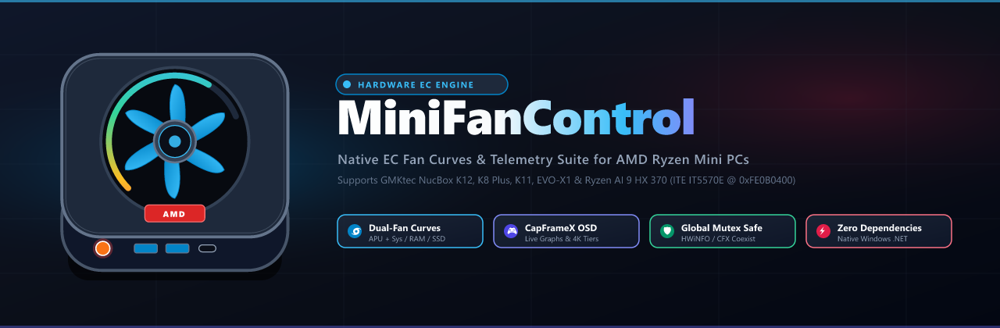
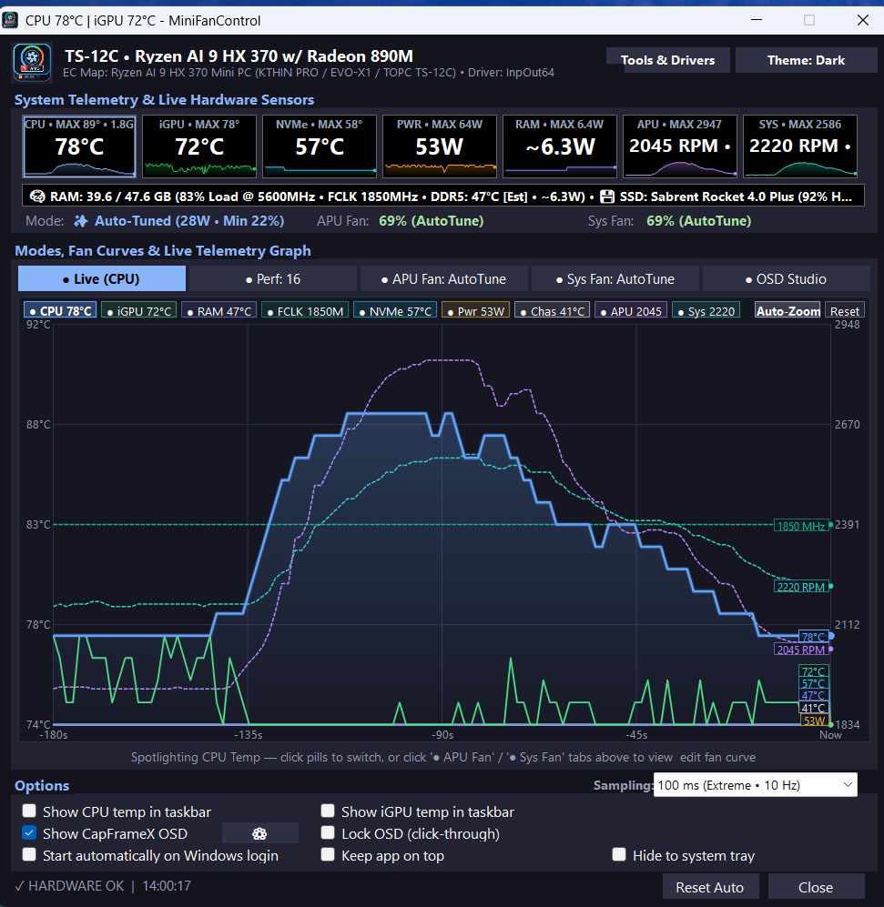
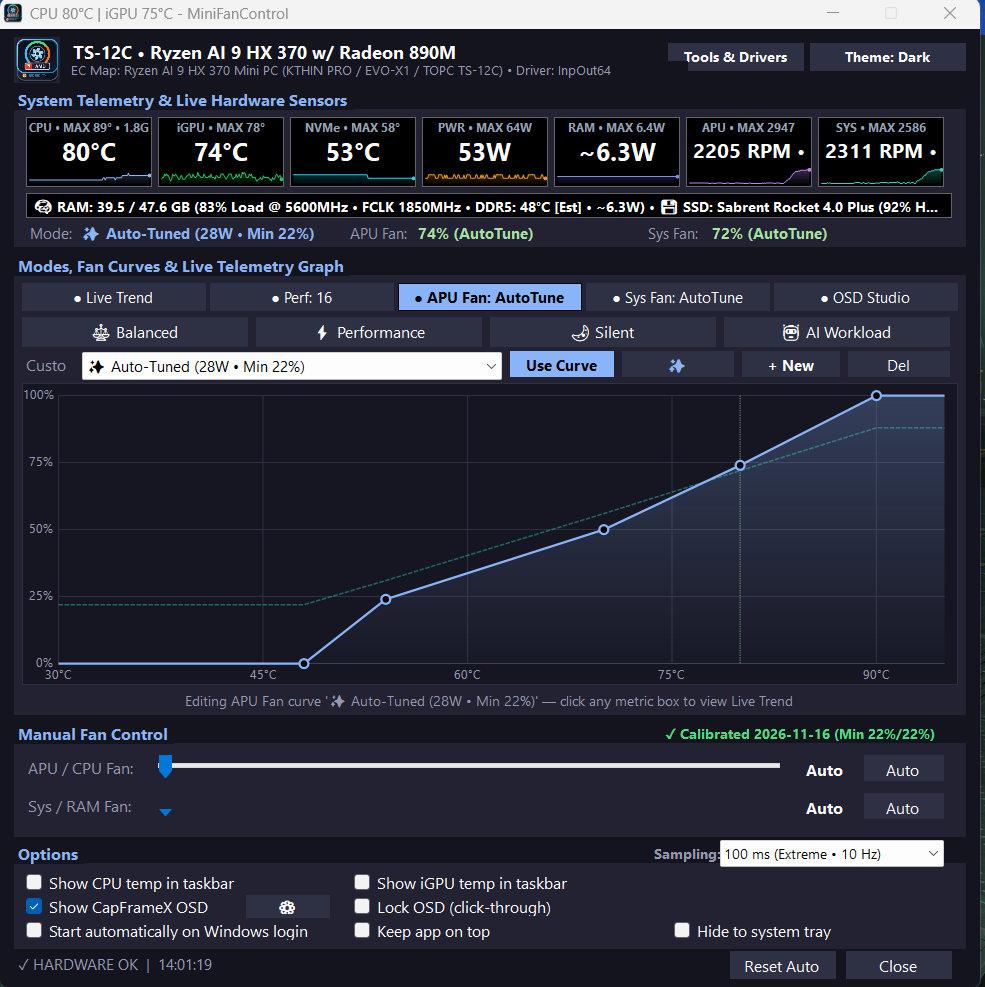
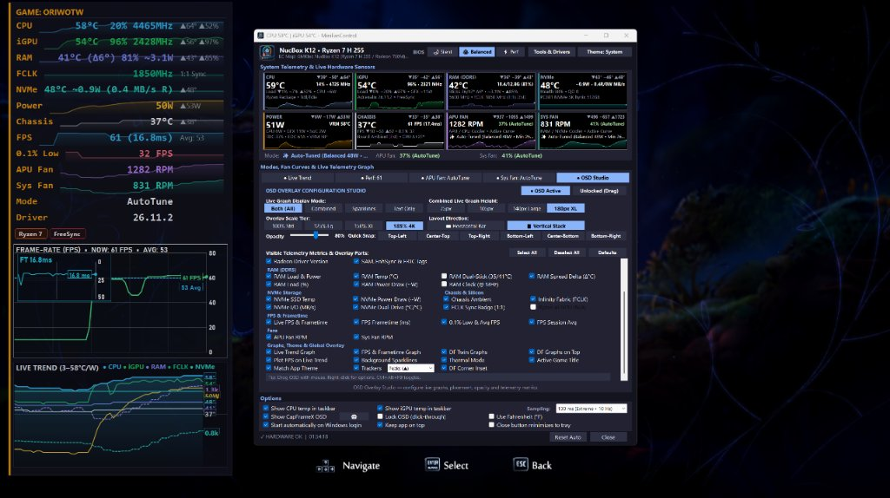
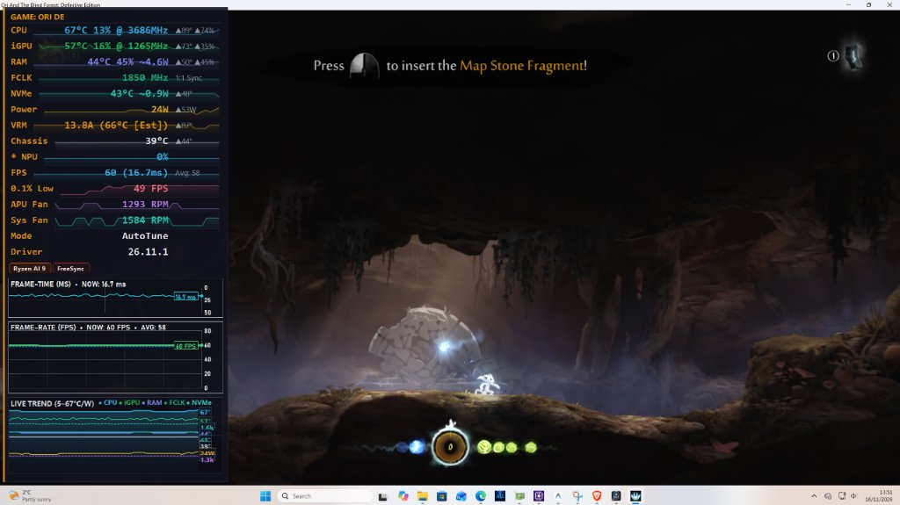

# MiniFanControl — Native EC Fan Control & Thermal Monitor for AMD Ryzen Mini PCs


<p align="center">
  
</p>

<p align="center">
  
</p>

[](https://github.com/kaiserc/MiniFanControl/releases)
[](#-quick-start-windows)
[-brightgreen.svg)](https://github.com/kaiserc/MiniFanControl/actions)
[](#-capframex--hwinfo-coexistence-globalaccess_ec)
[-success.svg)](#-automated-hardware-safety--curve-test-suite-7777-passing)
[](#-3-high-contrast-themes)
[](https://ko-fi.com/kaiser76)

**MiniFanControl** is a lightweight, zero-dependency **Windows (C#/.NET)** Embedded Controller (EC) & Super I/O fan control, custom fan curve, and hardware telemetry monitoring utility built specifically for **AMD Ryzen Mini PCs**—supporting the **GMKtec EVO-X1 (Ryzen AI 9 HX 370)**, **ADREAMER AriesBox 10 (Ryzen 7 7840HS)**, **TOPC TS-12C**, **GMKtec NucBox K12 (Ryzen 7 H 255 / 8845HS)**, **GMKtec K8 Plus / K11**, and other Zen 4 / Zen 5 Mini PCs with **ITE IT8613E** LPC Super I/O and **ITE IT5570E** EC controllers.

> 📖 **Walkthroughs & Technical References**:  
> - [**Complete User & Hardware Tuning Guide (GUIDE.md)**](GUIDE.md): In-depth walkthrough for fan calibration, motor stall prevention, OSD Studio customization, multi-monitor gaming, and EC register probing.  
> - [**Visual Overview Slide Deck (docs/MiniFanControl-Overview.pptx)**](docs/MiniFanControl-Overview.pptx): 7-slide visual presentation illustrating the architecture, dual-fan curves, OSD Studio, and `Global\Access_EC` mutex.  
> - [**Hardware Validation & Bench Testing Matrix (HARDWARE_VALIDATION.md)**](HARDWARE_VALIDATION.md): 6-profile register validation specifications, oscilloscope bench test protocols, and inverted Super I/O PWM polarity mapping.  
> - [**Changelog (CHANGELOG.md)**](CHANGELOG.md): High-level version history and release milestones.  
> - [**Contributing & Hardware Submissions (CONTRIBUTING.md)**](CONTRIBUTING.md): Core safety principles, local build guide, and step-by-step instructions for adding new Mini PC profiles.  
> - [**Release Notes & Architecture Log (RELEASE_NOTES.md)**](RELEASE_NOTES.md): Comprehensive documentation of architectural hardening phases and deep dives.

---

## 💡 Why MiniFanControl?

Standard desktop fan utilities (such as [Fan Control](https://getfancontrol.com/) or motherboard vendor tools) look for desktop Super I/O chips over standard LPC I/O ports. AMD Ryzen Mini PCs are engineered like modern gaming laptops: they rely on a proprietary **ITE IT5570E Embedded Controller (EC)** mapped at `0xFE0B0400`. 

Because desktop utilities cannot detect this controller, Mini PC users were historically limited to fixed BIOS profiles or high noise levels. **MiniFanControl** communicates directly with the Embedded Controller registers via kernel port I/O, providing independent dual-fan curves, live sparkline telemetry, an interactive CapFrameX-style in-game OSD, and taskbar temperature badges.

---

## 🏛️ Project Architecture & Domain Organization

The codebase is organized into cleanly separated domain modules supporting both native Windows builds and SDK-style multi-targeting (.NET Framework 4.8 / .NET 10.0-windows):

```
MiniFanControl/
├── Core/               # Controller service, settings persistence, OSD config, profiles & themes
│   ├── AppSettings.cs
│   ├── DeviceProfile.cs
│   ├── FanControllerService.cs
│   ├── FanStatus.cs
│   ├── Localization.cs
│   ├── OsdOverlayConfig.cs
│   ├── TelemetrySessionStats.cs
│   └── ThemePreference.cs
├── Curves/             # Curve interpolation math & 3-pass automated calibration engine
│   ├── CurvePoint.cs
│   └── FanCalibrationResult.cs
├── Hardware/           # Ring-0 hardware abstraction, mutex synchronization & AMD sensors
│   ├── AmdAdlGpuSensor.cs
│   ├── DemoBackend.cs
│   ├── DriverServiceManager.cs
│   ├── EcBusMutex.cs
│   ├── HardwareBackend.cs
│   ├── NativeInpOut.cs
│   └── SystemStorageMemorySensor.cs
├── Safety/             # Out-of-process crash supervisor daemon & IPC heartbeat watchdog
│   └── WatchdogSupervisor.cs
├── Telemetry/          # RTSS/CapFrameX shared memory reader & transparent OSD HUD
│   ├── CapFrameXOverlayForm.cs
│   └── FpsMonitor.cs
├── Tests/              # 77-point automated hardware safety & regression test suite
│   └── SelfTestSuite.cs
├── Ui/                 # Double-buffered canvases, accessible WinForms controls & dialogs
│   ├── AppLogoRenderer.cs
│   ├── DoubleBufferedPanel.cs
│   ├── FanCalibrationDialog.cs
│   ├── FanCurveCanvas.cs
│   ├── LivePerformanceCanvas.cs
│   ├── LiveTelemetryCanvas.cs
│   ├── MainForm.cs
│   ├── NewModeDialog.cs
│   └── SetupAssistantDialog.cs
├── .github/            # GitHub Actions CI/CD workflows & structured issue templates
│   ├── workflows/ci.yml
│   └── ISSUE_TEMPLATE/
├── Program.cs          # CLI dispatcher, headless automation helper & GUI entry point
├── MiniFanControl.csproj # Multi-target SDK project file (.NET 4.8 & .NET 10)
└── build-windows.bat   # Non-destructive atomic compiler script (.old.exe rotation)
```

---

## 💻 Hardware Compatibility Matrix

| System Model / Platform | Processor | Controller / Super I/O | Dual Fans | Control Mode |
| :--- | :--- | :--- | :---: | :--- |
| **GMKtec EVO-X1 / TOPC TS-12C** | AMD Ryzen AI 9 HX 370 (Radeon 890M) | ITE IT8613E Super I/O + EC | ✅ Yes | **Verified Native (Dual PWM)** |
| **GMKtec NucBox K12** | AMD Ryzen 7 H 255 / 8845HS (Radeon 780M) | ITE IT5570E EC @ `0xFE0B0400` | ✅ Yes | **Verified Native (Dual EC)** |
| **GMKtec NucBox K8 Plus / K11** | AMD Ryzen 7 8845HS / 8945HS | ITE IT5570E EC @ `0xFE0B0400` | ✅ Yes | **Verified Native (Dual EC)** |
| **ADREAMER AriesBox 10 / PB07** | AMD Ryzen 7 7840HS (Radeon 780M) | ITE IT5570E EC @ `0xFE0B0400` | ✅ Yes | **Verified Native (Dual EC)** |
| **Generic Zen 4 / Zen 5 Mini PC** | AMD Ryzen 7000 / 8000 / AI 300 series | ITE IT5570E / Aptio V EC | Auto | **Verified Auto Detection** |
| **Unrecognized / Unsupported System** | Any unverified CPU / Motherboard | Unverified | — | **Safe Read-Only Mode (Writes Locked)** |

> 🛡️ **Fail-Closed Hardware Protection**: If run on an unverified platform, MiniFanControl engages **Safe Read-Only Monitoring Mode**. Telemetry (temperatures, clocks, package power) remains visible, but all hardware write operations are locked to guarantee physical safety. Advanced users can manually select a verified profile under **Tools & Drivers ▾**.

---

## 🚀 First-Time Setup & Auto-Tune Guide (Recommended 2-Step Flow)

MiniFanControl includes an interactive **First-Time Setup Assistant** that automatically opens on initial launch if fan calibration has not yet been performed (also accessible anytime via **Tools & Drivers ▾ → ✨ First-Time Setup Assistant & Auto-Tune Guide...**).

For the quietest acoustics and 100% anti-stall safety, follow this recommended 2-step setup:

```
[ Step 1: Calibrate Fans ]  ===>  [ Step 2: Synthesize Auto-Tune ]  ===>  [ Step 3: Enjoy Quiet Cooling ]
  Discovers true stall floor       Synthesizes dynamic 5-point curve        Whisper-quiet ~750 RPM idle
  (e.g. 22% / 24% vs generic 30%)   around your measured floor & TDP knee    with 100% anti-stall protection
```

1. **Step 1 — Calibrate Fan Motors First**:
   - Small brushless blower fans stall if driven below their physical electromagnetic spin-up threshold.
   - Without calibration, MiniFanControl defaults to a conservative **30% PWM floor (~1400 RPM)**.
   - Running the 3-pass calibration engine tests both the APU cooler and secondary DDR5/NVMe chassis fan, safely discovering the exact hardware stall floor (e.g. **22% PWM / ~750 RPM** on the TOPC TS-12C).
2. **Step 2 — Synthesize Auto-Tuned Curve (`✨ Auto-Tune`)**:
   - The Auto-Tune engine synthesizes an optimal 5-point fan curve based on your measured stall floor, thermal idle baseline, and APU power envelope (28W vs 54W TDP).
   - **Why Auto-Tune is Dramatically Better AFTER Calibration**:
     - *Uncalibrated*: Auto-Tune starts at the generic 30% floor (~1400 RPM, audible whir).
     - *Calibrated*: Auto-Tune starts at your true 22% floor (**~750 RPM, whisper-quiet idle with >50% acoustic noise reduction**).
3. **Step 3 — Activate Curve & Monitor**:
   - Click **Use Curve** to apply your synthesized curve to hardware EC registers.
   - Toggle **Show In-Game OSD overlay** to monitor temps, APU power, fan RPM, and in-game frametimes in real time.
   - Click **Reset Auto** anytime to return full control back to native BIOS.

---

## ✨ Key Features

### 🖥️ Modern High-DPI Interface & Wide 2-Column Mode
<p align="center">
  
</p>

- **Dedicated Hardware Header & Live `BIOS:` Power Mode Bar**: Displays detected product model and APU, an independent **`BIOS: [🌙 Silent] [⚖ Balanced] [⚡ Perf]`** TDP switcher (EC `0x31`/`0x32`, decoupled from your Custom Fan Curves), quick **Tools & Drivers ▾** menu, and theme switcher.
- **Expanded 2×4 Telemetry Grid with `▼Low ~Avg ▲High` & Sparklines**:
  1. **CPU & iGPU Temps**: Direct silicon junction (`Tctl/Tdie`) + Radeon iGPU telemetry via AMD ADL2 PMLOG (`atiadlxx.dll`), with load %, clock MHz, and session ranges.
  2. **RAM (DDR5) & NVMe SSD**: Dual-stick DDR5 temps/spread/power/FCLK and NVMe temp/health/throughput (`MB/s`).
  3. **APU Power (W) & Chassis Ambient**: Package PPT, CPU/GFX/SoC rail split, TDC/EDC VRM currents, board ambient, and live RTSS FPS/lows.
  4. **APU Fan & Sys Fan RPM**: Live tachometer speeds with high-load zero-glitch debounce, implausible spike filtering, active curve status, and `100% (Emergency)` override indicators.
- **Telemetry Safety & Storage Integration**:
  - **PCIe & NVMe Bus Safety**: Uses thread-safe AMD kernel driver APIs (`atiadlxx.dll`) for telemetry rather than uncoordinated raw `0xCF8/0xCFC` I/O ports, guaranteeing your NVMe SSD storage controller remains uninterrupted.
  - **Thermal History & CSV Export**: Record up to ~10,000 live telemetry samples with 1-click CSV export under **Tools & Drivers ▾** for benchmarking and temperature analysis. Modeled metrics are explicitly flagged with `[Est]`.
  - **Live Sparkline Waveforms**: 118×21 px real-time mini charts inside each box. Click any box to spotlight that metric in the live telemetry graph!

### 📈 Multi-Series Live Telemetry Graph & Custom Curves
<p align="center">
  
</p>

- **Combined Live Trend**: Visualizes the last ~180 seconds of CPU temp, iGPU temp, APU power, APU fan RPM, and Sys fan RPM on dual synchronized vertical axes.
- **Interactive Spotlighting**: Click any legend pill or status box to highlight that metric while dimming others.
- **Independent Dual-Fan Curves (`APU Fan` + `Sys Fan`)**: Assign built-in modes (`Balanced`, `Performance`, `Silent`, `AI Workload`) or custom user-defined curves to each fan independently.
- **4 Protected Reference Example Curves (`🔒`)**: Includes `🔒 Zero-RPM Desktop Idle`, `🔒 Gaming Sweet-Spot (Acoustic Knee)`, `🔒 24/7 Server / Local LLM Sustained`, and `🔒 Max Cooling / Benchmark`—editable on the graph with a 1-click **Reset** button (replacing `Del`) that restores factory points without ever losing the reference templates.
- **`✨ Auto-Tune` Curve Synthesizer**: One-click synthesis of a calibrated 5-point curve applied to **both** APU Fan and Sys Fan automatically, dynamically adapting its acoustic knee (`Silent 35W` / `Balanced 48W` / `Perf 60W+`) whenever you switch the top `BIOS:` power mode.
- **Live Curve Operating Callout**: Displays the live driving sensor, target duty %, and real-time RPM directly on the curve (`CPU 45°C • 26% • 972 RPM` / `NVMe 49°C • 26% • 539 RPM`).
- **Hardware-Safe 4°C Asymmetric Hysteresis**: Cooldown hysteresis buffer eliminates fan speed oscillation during bursty workloads.

### 🎮 Hook-Free In-Game OSD Overlay & Dedicated OSD Studio
<p align="center">
  
</p>
<p align="center">
  
</p>
<p align="center">
  <strong>▶ <a href="assets/osd-demo.mp4">Watch 1080p Live In-Game OSD Demo Clip (Ori and the Will of the Wisps — Vertical OSD, DF Twin Graphs &amp; Filtered Live Trend)</a></strong>
</p>

- **On-Screen Display HUD**: Floating, translucent, always-on-top hook-free overlay for gaming and benchmarking (use Borderless Windowed or Windows 11 Fullscreen Optimizations for DX11 Exclusive Fullscreen titles).
- **Dedicated OSD Studio Tab**: Configure all overlay parameters directly inside the main window:
  - **5 Live Graph Display Modes**: `Both (All)`, `Combined`, `Sparklines`, `Text Only`, or **`Graphs Only`** (hides all metric text rows non-destructively while letting you toggle individual DF / Live Trend graphs).
  - **Digital Foundry `DF Corner Inset`**: Compact 30-sample inverted Frame-Time stutter box tucked inside the top-left corner of the panoramic FPS chart (with `1%` & `0.1%` lows and shaded `0.1%` floor band).
  - **4 Scale Tiers**: `100% Std`, `125% Lg`, `150% XL` (ideal for 1440p), and `185% 4K` (large bold readouts for 4K TV couch gaming).
  - **Layout Directions**: `▬ Horizontal Bar` or `▮ Vertical Stack`, plus right-click **`Sampling Rate`** (`100 ms` – `3000 ms`) directly on the overlay.
  - **Adjustable Graph Heights**: 75px Compact, 105px Medium, 140px Large, 180px XL.
  - **Quick Corner Snaps**: One-click snap to `Top-Left`, `Center-Top`, `Top-Right`, `Bottom-Left`, `Center-Bottom`, or `Bottom-Right`.
  - **Click-Through Lock (`WS_EX_TRANSPARENT`)**: Mouse clicks pass straight through to full-screen games without stealing focus.
  - **Low-Impact FPS & iGPU Load**: Passively reads in-game FPS from RTSS shared memory with zero DLL injection and zero anti-cheat risk; automatically displays live Radeon 3D engine load % and clock MHz directly from AMD ADL2.
- **Global Keyboard Hotkeys**: Toggle the overlay (`Ctrl+Alt+F9`) or switch thermal modes (`Ctrl+Alt+F10..F12`) anytime without leaving games.

### ⏱️ Digital Foundry Frametime & Stutter Analysis (`Split (DF)` / `DF Zoom` / `DF Corner`)
<p align="center">
  
</p>

- **4 Performance Views**: Cycle **`Split (DF)`**, **`🔍 DF Zoom`** (30-sample zoomed Frame-Time + full FPS), **`◰ DF Corner`** (compact top-left Frame-Time inset inside panoramic FPS), and **`Combined`** with live `AVG`, `1% Low`, and shaded `0.1% Low` floor.
- **Anti-Poisoning Startup Protection**: Rejects initial loading hitches and alt-tab drops so `1%` / `0.1%` low calculations reflect true gameplay pacing.
- **One-Click Timeline Snapshot & Export**: Export high-resolution PNG reports or scrub across the live gameplay history with sample-rate-accurate timestamps directly from the `Perf` tab.

### 🛡️ Motor Stall Protection & Universal Laptop / Handheld / Mini-PC 3-Pass Calibration
- **Physical Stall Dead-Zone Prevention**: Brushless blower fans stall if driven below their physical spin-up threshold. MiniFanControl sweeps from `12%` to `100%` with a 1-second rolling steady-state settle window (`> 40 RPM/s`) and adds a `+2%` safety margin.
- **Live Thermal Safety Abort (`≥ 88°C`)**: Protects compact mini-PC, laptop, and handheld coolers by automatically pulsing 100% cooling and aborting calibration safely if a background load heats the APU during coast-down or low-PWM steps.
- **1-Fan vs 2-Fan Auto Detection**: Detects single-fan vs dual-fan systems during calibration, automatically tailoring the UI and OSD layout.
- **Fail-Safe Exit Handler**: Automatically restores fan control registers to native BIOS EC Auto (`0x00`) on process exit or crash.

### 🔄 Multi-Tool Coexistence (`Global\Access_EC` Mutex)
- Acquires both `Global\Access_EC` and `Global\Access_ISABUS.HTP` mutexes with least-privilege permissions (`Synchronize | Modify`) before every register read or write.
- Avoids collisions and register corruption with third-party diagnostic and monitoring tools that honor the industry-standard `Global\Access_EC` and `Global\Access_ISABUS.HTP` mutexes (such as **HWiNFO64**, **CapFrameX**, and **LibreHardwareMonitor**).
- **Fail-Closed Protection**: If mutex creation or acquisition fails, hardware access strictly aborts—never running uncoordinated.
- **Synchronized Hardware Probing**: Super I/O discovery (`0x2E/0x4E`) runs inside synchronized mutex scopes to prevent bus collisions during initial hardware detection.

### ⏱️ Independent Watchdog Supervisor & Register Read-Back Verification
- **Out-of-Process Safety Daemon**: Runs as an independent process (`minifan-helper.exe --watchdog --pid <PID>`).
- **Heartbeat IPC**: Monitors main application health via named events (`Global\MiniFanControl_Heartbeat_<PID>`). Unnamed event fallbacks are strictly rejected fail-closed.
- **Automatic Failsafe Restoration**: If the main process hangs for >3.5s or terminates unexpectedly, the watchdog immediately resets fan registers to BIOS Auto (`0x00`) and verifies the hardware state via register read-back before confirming recovery.
- **Emergency Thermal Safety Tripwire**: If CPU temperature reaches ≥90°C, an emergency hardware override triggers 100% full-blast cooling immediately, returning to curve control only after cooling below 75°C.
- **Write Verification**: `SetMode`, `SetFan`, `SetAuto`, and `WriteReg` verify register latching and return explicit status codes, ensuring CLI automation never reports false successes.

### 💾 Native NVMe Storage, Multi-Drive I/O & System RAM Hardware Telemetry
- **Multi-NVMe Drive Support & Real-Time Throughput**: Queries NVMe SMART Log Page `0x02` directly through the Windows storage stack (`IOCTL_STORAGE_QUERY_PROPERTY`) and disk performance metrics (`IOCTL_DISK_PERFORMANCE`). Accommodates primary and secondary M.2 NVMe SSDs (`PhysicalDrive0` and `PhysicalDrive1`), real-time Read and Write throughput (MB/s), active I/O queue depth, remaining life %, and critical warnings without touching raw PCI configuration ports.
- **DDR Dual Data Rate (MT/s) Effective Speed**: Calculates true Double Data Rate ($2\times \text{MCLK}$), rendering effective speeds (e.g. `5600 MT/s` / `5600MHz` when base MCLK is 2800 MHz) across the OSD overlay, Main Form, and Live Trend.
- **Dual Stacked SODIMM Temperature Monitoring**: In Mini PCs, SODIMM slots are physically stacked one on top of the other, causing the upper module (DIMM 1) to run substantially hotter than the lower module (DIMM 0). MiniFanControl monitors both physical sticks individually (`DdrTemp1` and `DdrTemp2`), reads JEDEC SPD5118 on-die thermal sensors via AMD SMBus (`0x50` and `0x51`), tracks individual session peaks, and cleanly accommodates single-stick systems.
- **Proactive Fan 2 (Sys Fan) NVMe & RAM Thermal Coupling**: Drives Fan 2 using $\max(\text{APU Temp}, \text{NVMe Temp}, \text{RAM Temp})$—locking to the hotter stacked SODIMM stick to prevent heat-soak during sustained local LLM inference, gaming, or heavy file transfers.
- **Motherboard Chassis Ambient Temperature**: Reads physical motherboard ambient temperature directly from Super I/O IT8613 Channel 6 (`0x2E`), enabled out-of-the-box on the overlay, Live Trend, and main window.
- **Interactive GUI & OSD HUD Integration**: Features dedicated pill cards in the dashboard with rich SMART tooltips, live CapFrameX overlay rows, and CSV telemetry session exports.

### 📊 Telemetry Architecture & Sensor Sources Breakdown

To ensure zero driver conflicts and maximum stability, MiniFanControl strictly isolates sensor acquisition mechanisms:

| Telemetry Metric | Primary Sensor Provider | Driver / API Mechanism | Isolation & Safety Design |
| :--- | :--- | :--- | :--- |
| **CPU Core Temp (Tctl)** | AMD Silicon & EC | SMN `0x00059800` & `atiadlxx.dll` | Direct Zen 5 silicon junction decode (HWiNFO64 parity) |
| **iGPU Graphics Temp** | AMD Radeon ADL2 | Official AMD `atiadlxx.dll` | Official WHQL-certified driver interface |
| **APU Package Power (PPT)**| AMD ADL2 PMLOG | `atiadlxx.dll` (Hardware Rails) | Direct silicon sensor (TDP & rail breakdown) |
| **Ryzen AI NPU Load & Clock**| AMD ADL2 PMLOG | `atiadlxx.dll` (PMLOG Sensors) | Direct silicon NPU activity & frequency |
| **VRM Current & FCLK** | AMD SMU / SMN Bus | PCI Aperture `0xCF8/0xCFC` (Bus 0) | Direct silicon mailbox read with whitelist |
| **APU & Sys Fan RPM** | ITE IT8613E / IT5570E | Super I/O & Kernel Port I/O | Synchronized via `Global\Access_EC` mutex |
| **NVMe SSD Temp & Throughput**| Windows Storage Stack | `IOCTL_STORAGE_QUERY_PROPERTY` & `IOCTL_DISK_PERFORMANCE` | Multi-drive composite temp, health %, and R/W MB/s |
| **System RAM Load & Speed**| Windows OS Kernel | `GlobalMemoryStatusEx` & ADL2 | Dual Data Rate ($2\times \text{MCLK}$), e.g. 5600 MT/s |
| **DDR5 SPD Hub Temps (Dual)**| AMD FCH SMBus Controller | JEDEC SPD5118 I2C `0x50` & `0x51` | Synchronized via `Global\Access_SMBUS.HTP.Method` |
| **Chassis Ambient Temp** | ITE IT8613E Super I/O | Channel 6 Register `0x2E` | Continuous motherboard ambient thermistor |
| **In-Game FPS & Frametimes**| RTSS / CapFrameX | Win32 Named Shared Memory | Read-only passive memory mapping (no DLL injection) |
| **Radeon Feature Suite** | AMD Radeon Software | Registry / Runtime Enumeration | FreeSync, Anti-Lag, AFMF 2, FSR, Boost, Chill, RSR, RIS, EnhSync, SAM, FRTC (with KMD toggles in Tools & Drivers) |

---

## 🔒 Kernel Driver Architecture & Security Deep-Dive

### Multi-Driver Support: Bundled InpOut64 & WinRing0 Dynamic Abstraction
Mini PCs communicate with their embedded controller via raw ACPI I/O ports (`0x62/0x66`, `0x6C/0x6E`) and LPC Super I/O ports (`0x2E/0x2F`, `0x4E/0x4F`, `0x0A30–0x0A37`). Because 64-bit Windows prohibits user-mode processes from executing raw x86 `IN`/`OUT` CPU instructions, a kernel-mode driver service is required.

MiniFanControl features a **unified multi-driver abstraction** in [`Hardware/NativeInpOut.cs`](Hardware/NativeInpOut.cs) with dynamic API loading (`LoadLibraryEx` + `GetProcAddress`), supporting multiple hardware access driver engines:

1. **InpOut64 (`inpoutx64.dll` / `inpoutx64.sys`) — Primary Bundled Engine**:
   - Developed by Phillip Gibbons (Highresolution Enterprises / Red Fox UK), v1.5.0.0.
   - Bundled with MiniFanControl and prioritized directly from the application directory.
   - Verified SHA256 binary pin: `5F27ED4D5CD58A1EE23DEEB802E09E73F3A1D884CE2135F6E827F67B171269E7`.
   - Isolated port I/O and linear memory mapping.
2. **WinRing0 1.3.1b (`WinRing0x64.dll` / `WinRing0.sys`) — Optional Fallback**:
   - Engine used by LibreHardwareMonitor and OpenHardwareMonitor.
   - Loaded as secondary fallback only if placed in the application folder (**System32 is never probed** to eliminate DLL hijacking and silent engine substitution).
   - Direct port I/O and per-access direct physical memory IOCTLs with live read-back verification.
3. **PawnIO Integration (Architectural Roadmap)**:
   - Real PawnIO executes scriptable Pawn bytecode modules via `PawnIOLib` (`pawnio_open` / `pawnio_load` / `pawnio_execute`).
   - Integration with the authentic PawnIO SDK is planned on the roadmap to enable certified, EV-signed, HVCI-compatible hardware control without relying on vulnerable legacy drivers.

### Windows 11 Memory Integrity (HVCI) & Security Recommendations
1. **Memory Integrity (HVCI) Compatibility**: Both legacy `WinRing0.sys` (CVE-2020-14979) and `inpoutx64.sys` are flagged by Microsoft under the Windows 11 Microsoft Vulnerable Driver Blocklist because they permit raw port and physical memory access.
2. **Safe Read-Only Telemetry Default**: MiniFanControl **recommends keeping Memory Integrity ENABLED**. If Windows Defender blocks kernel driver loading or if launched without elevation, MiniFanControl does not crash—it automatically engages **Safe Read-Only Telemetry Monitoring Mode**. All CPU/iGPU temperatures, APU package power, GPU load, clocks, voltages, NVMe temperatures, and RAM load continue updating natively via AMD's official WHQL-certified driver interface (`atiadlxx.dll` / `amdfendrm.sys`) and Windows APIs, requiring zero unsigned kernel drivers and zero raw port I/O, while fan writes are safely disabled fail-closed.
3. **If You Choose to Enable Hardware Fan Control**: If you decide to toggle off Memory Integrity to allow custom fan curve writing, remember that you are reducing kernel memory isolation protections. Always ensure you download MiniFanControl from official repository releases and re-enable Memory Integrity if you cease using custom hardware fan curve writers.
4. **Anti-Cheat Conflicts**: Competitive kernel-level anti-cheat software (such as Riot Vanguard, Easy Anti-Cheat, and BattlEye) may flag kernel drivers while running. Use `minifan-helper.exe driver-stop` before launching competitive games.

### How MiniFanControl Hardens Driver Access (Defense-in-Depth)
MiniFanControl wraps all ring-0 driver operations inside a strict user-mode defense layer in [`Hardware/NativeInpOut.cs`](Hardware/NativeInpOut.cs):
- **Strict Fail-Closed Port Whitelist Enforcement**: `IsPortWhitelisted()` strictly permits only documented ACPI EC, Super I/O, and PCI SMN ports for reading and writing (`0x62/0x66`, `0x6C/0x6E`, `0x2E/0x2F`, `0x4E/0x4F`, `0x0A30..0x0A37`, `0xCF8/0xCFC`). Arbitrary unlisted port reads/writes and sensitive system ports (e.g., RTC `0x70/0x71`, PIC `0x20/0x21`, PIT `0x40..0x43`, Fast A20/Reset `0x92`, PCI reset `0xCF9`) are blocked fail-closed before touching the driver.
- **Strict Physical Memory Bounds**: `MapPhysToLinSafe()` and physical memory IOCTLs strictly enforce a minimum safe physical address boundary (≥ `0x000E0000`, protecting low memory and kernel tables) with a 16 MB maximum size ceiling. Linear mapping is restricted to live driver virtual mappings; disconnected heap snapshots are rejected.
- **Safe Driver Shutdown for Gamers**: Users playing competitive multiplayer titles can immediately unload active driver services (`WinRing0_1_2_0` or `inpoutx64`) without rebooting by running:
  ```powershell
  .\minifan-helper.exe driver-stop
  ```
- **Future Roadmap**: The project is architected so the `NativeInpOut` wrapper can transition to modern, cryptographically signed driver frameworks (such as PawnIO) as certified open-source driver signing becomes accessible.

---

## 🤝 How to Contribute a New Mini PC Hardware Profile

We welcome community hardware profiles for new Zen 4 / Zen 5 Mini PC models! Here is how to create and submit a profile:

1. **Dump EC Registers**:
   Run the diagnostic command to capture your system's 256-byte EC register map, motherboard DMI string, and LPC controller ID:
   ```powershell
   .\minifan-helper.exe dump > my_minipc_dump.txt
   ```
2. **Identify Active Control Registers**:
   Run the live register watcher for 15 seconds while toggling your BIOS performance mode or running a quick CPU stress test:
   ```powershell
   .\minifan-helper.exe watch
   ```
3. **Submit via GitHub**:
   Open a new issue on GitHub using our **[Hardware Compatibility Profile Request]** issue template, attaching the dump report. Our team will verify register offsets and add an active, verified profile to `Core/DeviceProfile.cs`.

---

## 🚀 Quick Start (Windows)

1. **Prerequisite**: Ensure a supported kernel driver DLL (`inpoutx64.dll` bundled, or optional `WinRing0x64.dll`) is located in the application folder (next to `MiniFanControl.exe`).
2. **Launch & Permissions**:
   - **Full Hardware Fan Control**: Right-click `MiniFanControl.exe` and select **Run as Administrator** (or install the Task Scheduler autostart task created by the installer) so the driver service can initialize its kernel handle.
   - **Safe Read-Only Telemetry**: When launched without elevation or when Windows Defender HVCI blocks kernel drivers, MiniFanControl starts cleanly in Safe Read-Only Telemetry Mode, reading APU power, temperatures, GPU clocks, NVMe SSD temp, and RAM load natively via AMD's official driver with full security intact.
3. **Run the App**: Double-click `MiniFanControl.exe` (or run `run-windows.bat`).
4. **Compile from Source**:
   - **Zero Tools Required (.NET 4.8 Framework)**: Double-click `build-windows.bat`. Compiles `MiniFanControl.exe` and `minifan-helper.exe` using the native `.NET Framework` compiler included with Windows 10/11.
   - **Modern .NET 10.0-windows SDK**: Run `dotnet build -c Release` to build modern Windows binaries targeting .NET 10.0-windows and .NET 4.8 multi-target.

---

## 🛠️ CLI Usage (`minifan-helper.exe`)

The included command-line tool provides full scripting, automation, and diagnostic capabilities:

```powershell
# Read live temperatures, fan speeds, and mode as JSON
.\minifan-helper.exe status

# Set EC performance mode (0 = Balanced, 1 = Performance, 2 = Silent)
.\minifan-helper.exe mode 0

# Set manual fan PWM % (1-100 = Manual %, 0 = Return to Auto)
.\minifan-helper.exe fan1 60
.\minifan-helper.exe fan2 45

# Reset both fans and mode to native BIOS automatic control
.\minifan-helper.exe auto

# Run 3-pass automated fan calibration (measures Min Spin %, Max RPM, and detects 1 vs 2 fans)
.\minifan-helper.exe calibrate

# Export 256-byte EC register hex dump & system diagnostic info (text or structured JSON)
.\minifan-helper.exe dump
.\minifan-helper.exe dump --json

# Live-watch all 256 EC registers for 15 seconds to identify active control registers
.\minifan-helper.exe watch

# Stop the kernel driver service before launching competitive anti-cheat games
.\minifan-helper.exe driver-stop

# Validate 6 hardware profiles, register layouts, and inverted polarity matrix
.\minifan-helper.exe hw-matrix

# Export supported hardware profiles & probed Super I/O chip ID prefixes as JSON
.\minifan-helper.exe export-profiles --json

# Execute the 77-point automated hardware safety & curve test suite
.\minifan-helper.exe test
```

---

## 🧪 Automated Hardware Safety & Curve Test Suite (77/77 Passing)

The built-in test suite (`minifan-helper.exe test` or automated upon running `build-windows.bat`) rigorously validates safety mechanisms without touching physical registers:

1. **Motor Stall Dead-Zone Protection**: Verifies fan speeds 1%–29% are clamped to safe minimums across 0°C–105°C.
2. **47°C Balanced Curve Stall Regression Test**: Confirms output never dips into the motor stall region at 47°C.
3. **Zero-RPM Idle Segment & Clean Step-Up**: Ensures fans stay at 0% in idle (<45°C) and step up cleanly (≥30%) above 51°C.
4. **Curve Boundary Clamping**: Verifies extreme inputs (15°C -> 0%, 99°C -> 100%) remain strictly bounded.
5. **Tachometer Stall Filter**: Filters tachometer anomalies (8000 and 65535 RPM mapped to 0, valid speeds preserved).
6. **EC Register Bitmask Encoding & Safety Bounds**: Validates 0x80 manual flag and clamped PWM bytes (0x32–0x34).
7. **Custom Curve Config Save/Load Round-Trip**: Verifies serialization and deserialization integrity across profiles.
8. **Multi-Model Ryzen Mini-PC Profile Matching**: Validates profile detection for K12, K8 Plus, HX 370, and AriesBox 10.
9. **Simulation Backend State Machine**: Tests manual fan overrides and failsafe return to BIOS Auto.
10. **Smart EC Candidate Scanner & Dynamic Register Override**: Validates runtime command-line register overrides.
11. **3-Pass Fan Calibration Engine, Date Tracking & Safety Margin**: Validates multi-pass calibration and +2% safety margin.
12. **CapFrameX `Global\Access_EC` Mutex & APU Power Breakdown**: Tests mutex acquisition and PPT breakdown tooltip.
13. **Session Peak/Min/Avg Telemetry & Multi-Series Live Graph History**: Tests telemetry rolling window and statistical tracking.
14. **CapFrameX OSD Multi-Tier Sizing, Live Graphs & Layout Modes**: Validates HUD geometry, scaling tiers, and rendering.
15. **Fail-Closed EcBusMutex Contention & Safe Mutex Isolation**: Verifies fail-closed behavior under cross-process lock contention.
16. **Emergency Thermal Safety Tripwire & Cooldown Hysteresis**: Tests instant 100% full-blast tripwire at ≥90°C and 75°C recovery.
17. **Safe Fail-Closed Hardware Probe Validation**: Verifies probe failures cleanly reject blind port I/O fallback.
18. **Hardware Watchdog Supervisor Lifecycle**: Tests clean shutdown handshake, heartbeat timeout triggers, and process crash recovery.
19. **Driver Security Port Whitelist & Memory Map Safety Bounds**: Validates port whitelist security and physical memory bounds checking.
20. **Unverified Hardware Fail-Closed Read-Only Protection**: Confirms unrecognized hardware platforms are locked to read-only mode.
21. **Session Telemetry CSV Export Integrity & Schema Validation**: Validates 15-column CSV export format, headers, and values.
22. **Missing-Mutex Fail-Closed Enforcement & Lock Security**: Verifies missing EC, ISA, PCI, or SMBus mutex triggers fail-closed isolation.
23. **Watchdog IPC Named-Event Fail-Closed & Auto Read-Back Verification**: Validates unnamed event fallback rejection and read-back state confirmation.
24. **Parameter Validation & Invalid Fan ID / Mode Rejection**: Verifies out-of-bounds fan IDs (0, 3, -1), PWM percentages (<0, >100), and performance modes (<0, >2) are strictly rejected fail-closed.
25. **Hardware Write Read-Back Verification & Read-Only Safety Protection**: Verifies read-back register mismatches, unverified read-only device profiles, and mutex contention strictly block writes and return `false`.
26. **Strict Fail-Closed Port Whitelist Enforcement**: Verifies unlisted and sensitive port reads and writes (`0x70/0x71`, `0x92`, `0xCF9`, `0x20/0x21`, `0x40..0x43`, `0x61`) are strictly blocked fail-closed.
27. **Centralized Hardware Initializer Safe Default**: Verifies default hardware initialization selects `unknown-safe` (`IsReadOnly = true`), preventing blind K12 writes.
28. **Super I/O Write Read-Back & Separate Restore Paths**: Validates `WriteSuperIoHwReg()` read-back checks, `RestoreNativeEcAuto()`, and `ApplySafeSuperIoFallback()`.
29. **Super I/O Write Failure Detection in `SetFan()`**: Verifies that any failed Super I/O configuration or PWM write is detected and causes `SetFan()` to fail closed.
30. **Thread-Safe Mutex Initialization & Concurrency Safety**: Verifies race-free, multithreaded initialization of `EcBusMutex` under high concurrency.
31. **Watchdog IPC Access Control List (ACL) Hardening**: Verifies named IPC events enforce least-privilege ACLs without inherited `Everyone` (`WorldSid`) or untrusted AppContainer (`S-1-15-2-1`) permissions.
32. **Native BIOS Auto vs. Safe Super I/O Fallback Distinction**: Validates clear distinction in status and description between native BIOS automatic mode and quiet safe Super I/O fallback.
33. **UI Write-Result Fail-Closed Handling & Independent Emergency Retries**: Verifies UI caches fan speeds ONLY upon confirmed hardware write/read-back verification, preserves prior state on rejected writes, alerts the user visibly, escalates persistent write failures to BIOS auto restore and read-only latch, and retries emergency 100% cooling independently every worker cycle.
34. **Watchdog Ready Handshake & Fail-Closed Event Fallback**: Verifies two-way child handshake (`ReadyEvent`) before confirming active supervision, ensures absence of unverified fallbacks, and tests fail-closed timeout detection.
35. **Multi-Profile Hardware Validation Matrix (6 Hardware Profiles)**: Rigorously verifies all 6 device profiles (`gmktec-k12`, `gmktec-k8-k11`, `ryzen-hx370-ec`, `adreamer-ariesbox10`, `generic-it5570e`, and `unknown-safe`), checking EC register bounds, Super I/O direct PWM mapping and safety bounds, tachometer channels, sensor loss / thermal runaway failsafe, watchdog recovery, and read-only protection.
36. **Authenticated Mutex DACL & Local Fallback Diagnostics**: Verifies `EcBusMutex` access rules enforce least-privilege `AuthenticatedUserSid` (`Synchronize | Modify`) without untrusted `WorldSid` (`Everyone`), ensuring `UsesLocalNamespaceFallback` and `MutexNamespaceDiagnostic` track namespace state accurately.
37. **Native NVMe Storage & System RAM Sensor Telemetry**: Verifies standard Win32 `IOCTL_STORAGE_QUERY_PROPERTY` NVMe SMART health page 0x02 parsing (Composite Temperature, Critical Warning, Available Spare %, Lifetime Wear %), native `GlobalMemoryStatusEx` physical RAM utilization (Total GB, Used GB, Load %), and `FanStatus` tooltip formatting helpers.
38. **Session Telemetry NVMe & RAM Power Tracking & Sparklines**: Verifies rolling history, peak/avg computations, and sparkline formatting for NVMe SSD temperature and estimated DDR5 memory power rails.
39. **High-Resolution RTSS Frametime, Average FPS & 0.1% Lows Telemetry**: Verifies mathematical percentile computation (99th and 99.9th percentile frame times) from 1,000 synthetic frame samples, session FPS bounds, frametime sparklines, and double-buffered OSD bitmap rendering.
40. **Hardware Validation Matrix Auto-Discovery & Polarity Testing**: Validates all 6 device profile configurations, EC register mapping bounds, direct Super I/O PWM duty mapping, and fail-closed read-only protection.
41. **OSD Driver Version & Afterburner Theme Integration**: Validates Afterburner theme palette styling, green/cyan contrast ratios, and Radeon driver version row rendering.
42. **OSD Center-Top & Center-Bottom Snap Location Geometry**: Validates multi-monitor snap calculations and non-overlapping coordinate positioning.
43. **OSD Granular Metric Toggle & Horizontal Auto-Width Expansion**: Validates metric toggle permutations and horizontal bar width auto-sizing across custom configurations.
44. **UI Layout Anti-Clipping Geometry**: Validates non-overlapping layout bounds across telemetry boxes, OSD Studio, and Options card.
45. **Digital Foundry Dual Graphs Dynamic Scale Ladder & Baseline Anti-Clipping**: Validates 60/120/180/240 ladder selection, rolling 20-sample window, and 4-tier heights (75px Compact, 105px Medium, 140px Large, 180px XL).
46. **Driver Engine Isolation & WinRing0 MMIO Heap-Mapping Prevention**: Validates linear map isolation (never heap snapshots), minimum physical memory bounds (≥ 0x000E0000), and direct device write verification.
47. **Strict Fail-Closed Dword Port Whitelist Aperture Enforcement**: Validates that 32-bit dword port reads/writes strictly permit only `0xCF8` and `0xCFC` for PCI SMN access.
48. **Safe Read-Only Telemetry Fallback When Kernel Driver Is Blocked**: Validates that unverified platforms or blocked kernel drivers gracefully return ADL/Storage telemetry without throwing unhandled exceptions.
49. **Single-Instance Mutex & Clean Driver Shutdown Lifecycle**: Validates single-instance guard (`Global\MiniFanControl_SingleInstance_GUI`) and complete driver resource de-initialization.
50. **Anti-Poisoning Gameplay 0.1% Lows & Startup Hitch Rejection**: Validates that 1-second loading pauses and RTSS initialization artifacts (1 FPS) never permanently corrupt or stick 0.1% low framerate metrics during active gameplay.
51. **AMD Silicon & ADL Extended Telemetry Validation**: Validates CPU core clocks, memory controller clock rates (DDR5/LPDDR5X), junction hotspot temperatures, and APU PPT power envelope limits.
52. **Tier 2 EC Motherboard Differential Sensor Scanner & Telemetry**: Validates ambient thermistors, VRM thermal zones, fan control PWM channels, and DC/ADC voltage telemetry discovery.
53. **Dynamic Custom DeviceProfile Generation, JSON Serialization & Unlocked Fan Control Lifecycle**: Validates on-the-fly hardware profile synthesis from scan diffs, JSON schema serialization, persistence, and safe unlocked manual control.
54. **Tier 3: AMD SMU / SMN Telemetry & Deep Silicon VRM / FCLK Bus Synchronization**: Validates direct silicon mailbox queries via `0xCF8`/`0xCFC`, real-time VRM amperage draw (TDC/EDC), Infinity Fabric (FCLK) ratio detection, and CapFrameX overlay integration.
55. **NPU Telemetry Utilization, "AI Workload" Fan Curve Profile & Proactive Thermal Coupling**: Validates built-in AI Workload profile curves, feed-forward NPU thermal coupling math to prevent localized NPU heat soak during local LLM inference, real-time NPU telemetry tracking in session statistics, CapFrameX overlay NPU column rendering, and PawnIO driver HVCI query safety.
56. **Localization Engine (Loc), Built-In Multi-Language Dictionaries & Community JSON Schema**: Validates the zero-dependency localization engine across all 6 built-in languages (English, Chinese Simplified, German, Spanish, French, Japanese), English fallback mechanisms, and community drop-in JSON translation file schema parsing.
57. **Live Performance Tab & Digital Foundry Frametime / Framerate Engine Integration**: Validates the dedicated Live Performance tab in the main window, Digital Foundry inverted frame-time jitter scaling with dynamic stutter headroom ceiling auto-scaling (50/75/100 ms), frame-rate dynamic headroom ladder (60/80/120/180/240 FPS), multi-language tab title resolution, and high-resolution timeline scrubbing.
58. **Live Trend First Tab Sequence, Dynamic Manual Fan Visibility & 1440p Taskbar Auto-Fit**: Validates primary tab reordering (`● Live Trend` 1st, `● Live Perf` 2nd, `● APU Fan` 3rd, `● Sys Fan` 4th, `● OSD Studio` 5th), dynamic manual fan control card and calibration badge hiding with +122px vertical graph expansion (490px canvas), and resolution-aware vertical clamping that strictly respects `Screen.WorkingArea` and the Windows taskbar on 1440p and high-DPI displays.
59. **Undeletable Protected Reference Curves (`🔒` Reset-Only) & `✨ Auto-Tune` Curve Synthesizer**: Validates the 4 protected reference curves (`🔒 Zero-RPM Desktop Idle`, `🔒 Gaming Sweet-Spot (Acoustic Knee)`, `🔒 24/7 Server / Local LLM Sustained`, `🔒 Max Cooling / Benchmark`), Reset-vs-Delete protection restoring factory curve points, and the `✨ Auto-Tune` curve synthesizer across 35W Eco vs 65W Performance TDP envelopes, calibrated anti-stall floors, and NVMe/NPU Sys Fan coupling.
60. **AMD Silicon Junction SMN Tctl/Tdie Decoding & HWiNFO64 Parity**: Validates direct AMD Zen 5 SMN silicon junction register decoding (`0x00059800`), sign/fraction extraction, and exact parity with HWiNFO64 Tctl/Tdie CPU junction sensors.
61. **Live Trend & Overlay Metric Ordering & Format Parity**: Validates canonical metric placement (RAM 3rd, FCLK 4th, Chassis Ambient) and consistent unit formatting across both UI and OSD.
62. **AMD FSR Upscaling Detection, Multi-NVMe I/O Throughput & RAM Dual Peaks**: Validates automatic detection of AMD FidelityFX Super Resolution, dedicated Radeon pill badge styling, multi-drive NVMe storage transfer rate tracking (R/W MB/s), and independent tracking of RAM temperature and memory load peaks.
63. **DDR Dual Data Rate (MT/s) Effective Speed & Dual Stacked SODIMM Temperature Tracking**: Validates memory transfer rate calculation at dual data rate ($2\times \text{MCLK} = 5600\text{ MT/s}$), dual stacked SODIMM temperature monitoring (`DdrTemp1` vs `DdrTemp2`), thermal stack differential ($\Delta T$), single-stick fallback, and proactive secondary fan coupling.
64. **CapFrameX-Inspired Phased `RefreshThrottle` Bus Optimization**: Validates decoupled, jitter-immune sampling intervals for slow storage/memory buses, deterministic grid timing, and staggered phase offsets between dual SODIMM modules to eliminate SMBus collisions.
65. **Hook-Free Overlay Zero-Impact Repaint Dirty-Check & Ryzen Processor Tier Badges**: Validates hash-based dirty checking to skip redundant GDI+ bitmap blits during active gaming, and authentic AMD Ryzen processor tier badge rendering (`Ryzen AI 9`, `Ryzen 9`, `Ryzen 7`).
66. **RAM & NVMe Dynamic Power Usage Readout (OSD, Live Trend Pills, Status Labels & Tooltips)**: Validates real-time DDR5 memory power wattage (`~4.8W`) alongside dual SODIMM temperatures (`37°/43°C (Δ6°)`) and clocks (`5600MHz`), and native dynamic `NvmePowerWatts` power envelope monitoring (~0.9W idle up to ~5.5W active per drive) coupled to real-time I/O throughput across tooltips, status sub-header, CapFrameX OSD, and Live Trend pills.
67. **Live Telemetry Auto-Zoom Scaling, Right-Axis RPM Decoupling & AMD Silicon Junction Fallback Parity**: Validates dynamic graph vertical autoscaling without clipping, independent right-axis fan RPM normalization (0–4000 RPM), and fail-safe CPU silicon junction temperature fallback.
68. **Cross-Process Watchdog IPC Verification & Child Lifecycle Handshake**: Spawns an actual independent child helper process (`minifan-helper.exe watchdog`), verifies full bi-directional IPC handshake (`ReadyEvent` signaled by child), validates AutoReset heartbeat pulse consumption without `UnauthorizedAccessException` (`Modify | Synchronize` permissions), and confirms clean graceful shutdown with exit code 0.
69. **Sleep & Suspend Lifecycle Protection**: Validates hardware worker pause upon entering ACPI S3/Modern Standby sleep, emergency thermal tripwire reset preventing stale latches on disconnected sensor float (0xFF = 255°C / 0x7F = 127°C), Super I/O quiet safe standby duty fallback (writing 0x00 Extended PWM mode with safe 35% duty to 0x15..0x17), and clean resume recovery re-arming the watchdog and worker thread.
70. **`DeviceProfile.FromJson` Colon Preservation**: Ensures JSON string values containing colons (`displayName`, `chipsetNotes`) are deserialized intact.
71. **Tokenizing `Loc` JSON Parser**: Validates single-line JSON, embedded colons, escaped quotes, and `\uXXXX` Unicode escape decoding.
72. **`OsdOverlayConfig` Defaults & Settings Round-Trip**: Verifies OSD visibility presets (`SelectAllMetrics` / `DeselectAllMetrics` / `ResetDefaults`) and `AppendSettings`/`TryParseSetting` persistence parity.
73. **Custom Controls Accessibility**: Confirms keyboard `TabStop` and UIA `AccessibleRole` (`PushButton` / `Chart`) metadata across interactive telemetry boxes and curve canvases.
74. **`FanControllerService` Decoupled Control & Tripwire**: Verifies decoupled curve evaluation, manual override, BIOS Auto reset transitions, and emergency thermal tripwire clamping.
75. **`DeviceProfile` CLI Export**: Verifies `export-profiles` JSON and summary table outputs include verified profiles and probed Super I/O chip-ID families.
76. **Hardware Probe JSON Export & Super I/O Chip Identification**: Verifies `dump --json` structured DMI/profile/Super I/O output and chip-ID naming for `ITE IT5570E` (`0x5570`), `ITE IT8613E` (`0x8613`), and `Nuvoton NCT67xx`.
77. **Calibrated 14% Floor, BIOS-Mode Auto-Tune & OSD v1.1.0 Config**: Verifies `EvaluateCurve()` honors calibrated `14%` minimum spin floors end-to-end, `SynthesizeAutoTunedCurve()` adapts TDP and acoustic knees across `Silent` (`35W`), `Balanced` (`48W`), and `Perf` (`60W+`), and `OsdOverlayConfig` round-trips `GraphMode = 4` (`Graphs Only`), `DfCornerInset`, and per-series Live Trend toggles (`TrendCpu`..`TrendSysFan`).

---

## 📊 Embedded Controller (EC) Register Map (`ITE IT5570E @ 0xFE0B0400`)

| Offset | Access | Description | Values / Formula |
|---|---|---|---|
| `0x31` | Read | Active Performance Mode | `0` = Balanced, `1` = Performance, `2` = Silent |
| `0x32` | Write | Set Performance Mode | `0x80` = Balanced, `0x81` = Performance, `0x82` = Silent |
| `0x33` | R/W | **APU Fan (`Fan 1`)** Control | `0x00` = Auto, `0x80 \| pct` = Manual (`1–100%`) |
| `0x34` | R/W | **Sys Fan (`Fan 2`, RAM/NVMe)** Control | `0x00` = Auto, `0x80 \| pct` = Manual (`1–100%`) |
| `0x35–0x36` | Read | **APU Fan (`Fan 1`)** RPM | `(reg[0x35] << 8) \| reg[0x36]` (Max ~3150 RPM; `8000` = motor stopped/idle) |
| `0x37–0x38` | Read | **Sys Fan (`Fan 2`)** RPM | `(reg[0x37] << 8) \| reg[0x38]` (Max ~1940 RPM; `8000` = motor stopped/idle) |
| `0x70` | Read | CPU Temperature | °C |
| `0x71` | Read | dGPU Temperature | `0` on APU models (Radeon iGPU temp is read via AMD `atiadlxx.dll`) |

---

## ⚙️ Configuration File Schema (`minifancontrol.cfg`)

MiniFanControl automatically persists user preferences and calibrated fan thresholds to `minifancontrol.cfg` in the application directory. Advanced users and headless deployment scripts can edit this file directly:

### 1. General & Hardware Settings
| Key | Type | Default | Description |
|---|---|---|---|
| `HardwareProfile` | String | `auto` | Active device profile (`auto`, `gmktec-k12`, `gmktec-k8-k11`, `ryzen-hx370-ec`, `adreamer-ariesbox10`, `unknown-safe`) |
| `HasDualFans` | Integer | `1` | `1` = Dual fans present (APU + Sys Fan), `0` = Single fan detected |
| `RefreshIntervalMs`| Integer | `500` | Telemetry polling rate in milliseconds (250ms = 4 Hz, 500ms = 2 Hz, 1000ms = 1 Hz) |
| `RestoreAutoOnExit`| Integer | `1` | `1` = Restore native BIOS EC control (`0x00`) on exit/crash, `0` = Retain last manual setting |
| `EnableHotkeys` | Integer | `1` | `1` = Enable global hotkeys (`Ctrl+Alt+F9` overlay, `Ctrl+Alt+F10..F12` modes) |
| `Theme` | Integer | `0` | `0` = Dark Theme, `1` = Light Theme, `2` = AMD Radeon Crimson Theme |
| `ShowCpuTray` | Integer | `0` | `1` = Show live CPU temperature badge icon in Windows system tray |
| `ShowGpuTray` | Integer | `0` | `1` = Show live iGPU graphics temperature badge icon in Windows system tray |

### 2. CapFrameX-Style OSD HUD & Graphs
| Key | Type | Default | Description |
|---|---|---|---|
| `ShowOverlay` | Integer | `1` | `1` = Enable in-game OSD overlay HUD, `0` = Disabled |
| `LockOverlay` | Integer | `0` | `1` = Enable `WS_EX_TRANSPARENT` mouse click-through for full-screen gaming |
| `OverlayVertical` | Integer | `1` | `1` = Vertical stack layout (`▮ Vert`), `0` = Horizontal status bar (`▬ Horiz`) |
| `OverlayX` / `OverlayY` | Integer | `100, 100` | Screen coordinates (pixels) of the overlay HUD |
| `OsdScaleTier` | Integer | `1` | HUD UI scaling: `0` = 100% Std, `1` = 125% Lg, `2` = 150% XL, `3` = 185% 4K |
| `OsdGraphMode` | Integer | `3` | Live graphs: `0` = Text Only, `1` = Sparklines, `2` = Combined Graph, `3` = Both |
| `OsdGraphHeight` | Integer | `65` | Base graph height in pixels (`45`, `65`, `95`, `130`) |
| `OsdOpacityPct` | Integer | `95` | Overlay background opacity percentage (`20%` to `100%`) |
| `OsdShowPeaks` | Integer | `1` | `1` = Show tracker column (`▲` / `▼` / `▼▲` / `~`), `0` = Hide |
| `OsdPeakTrackerMode` | Integer | `0` | `0` = Peaks (`▲`), `1` = Lows (`▼`), `2` = Min/Max (`▼▲`), `3` = Session Avg (`~`) |
| `OsdShowRadeonExtTags` | Integer | `1` | `1` = Include `SAM`, `EnhSync`, and `FRTC` pills in OSD Radeon tags, `0` = Hide |
| `UseFahrenheit` | Integer | `0` | `1` = Display all temperatures in Fahrenheit (`°F`), `0` = Celsius (`°C`) |
| `OsdShowFpsGraph` | Integer | `1` | `1` = Render dedicated FPS & Frametime (ms) chart at bottom of HUD |
| `OsdPlotFpsOnTrend`| Integer | `1` | `1` = Plot live framerate series inside the upper combined trend graph |
| `OsdShowCpu` / `Gpu` / `Nvme` / `Power` / `Ram` / `Fps` / `Lows` / `GpuLoad` / `ApuFan` / `SysFan` | Integer | `1` | Granular visibility toggles for individual telemetry rows (`1` = visible, `0` = hidden) |

### 3. Fan Motor Calibration & Curves
| Key | Type | Default | Description |
|---|---|---|---|
| `ApuMinSpinPct` | Integer | `24` | Primary APU fan physical minimum spin-up threshold % (prevents motor stall) |
| `SysMinSpinPct` | Integer | `22` | Secondary Sys fan physical minimum spin-up threshold % |
| `ApuMaxRpm` | Integer | `3150`| Calibrated maximum RPM speed of primary APU fan cooler |
| `SysMaxRpm` | Integer | `1940`| Calibrated maximum RPM speed of secondary chassis fan cooler |
| `ApuMode` / `SysMode` | String | `Balanced` | Active curve mode (`Balanced`, `Performance`, `Silent`, or custom profile name) |
| `CustomProfile` | String | `Name\|APU_Points\|SYS_Points` | Format: `Name\|42:0;55:30;68:50;80:75;90:100\|42:0;55:30;68:50;80:75;90:100` |

---

## 🔗 Official Drivers & Manufacturer Resources

Accessible directly inside the app via **`Tools & Drivers ▾`**:

- **GMKtec Official Drivers & Manuals (K12 & NucBox Series)**:  
  https://www.gmktec.com/pages/drivers-and-software
- **AMD Software: Adrenalin Edition & Chipset Drivers (Ryzen 7 H 255 / 780M & HX 370 / 890M)**:  
  https://www.amd.com/en/support/download/drivers.html  
  *(Installing the official AMD Adrenalin driver enables native Radeon iGPU temperature & APU power telemetry via `atiadlxx.dll`.)*

### Driver & Software Compatibility Matrix

| Setup | What Works | What Won't Work |
|-------|------------|-----------------|
| **Full AMD Adrenalin + InpOut64 (Recommended)** | All EC fan control, SMU/SMN, ADL iGPU/power telemetry, and all OSD Radeon pills (`FreeSync`, `RIS`, `AFMF`, per-game `FSR` & `Anti-Lag`, etc.) | — |
| **AMD Minimal / Driver-Only (`atiadlxx.dll` present, no Adrenalin UI)** | All EC fan control, SMU/SMN, ADL iGPU temp/hotspot/clock/power/NPU/FCLK telemetry, and driver `FreeSync` (VRR) | `RIS`, `AFMF`, and per-game `FSR` / `Anti-Lag` OSD pills (since `%LocalAppData%\AMD\CN\GExDb.blb` / `gmdb.blb` do not exist); `RadeonSoftwareVersion` falls back to `DriverVersion` |
| **No AMD Display Driver (e.g. Microsoft Basic Display Adapter)** | EC fan control & CPU/NVMe/RAM telemetry (if EC kernel driver is loaded) | All ADL iGPU sensors (temp/hotspot/clock/load/power/NPU/FCLK) and **all** Radeon OSD pills & driver version readout |
| **No EC Kernel Driver (`inpoutx64.dll` missing or blocked by HVCI)** | UI & non-EC telemetry only (or Demo Mode) | **Fan control & EC sensors** (APU/Sys RPM, fan curves, manual PWM, EC VRM/ambient); MiniFanControl displays a warning banner at the top of the window |

---

## ☕ Support & Donations

If MiniFanControl has improved your Ryzen Mini PC experience with whisper-quiet acoustics and custom cooling, consider supporting ongoing development, hardware testing, and future device profiles:

<p align="left">
  <a href="https://ko-fi.com/kaiser76">
    
  </a>
</p>

- **Ko-fi**: [ko-fi.com/kaiser76](https://ko-fi.com/kaiser76) *(Supports Apple Pay, Google Pay, Credit/Debit Cards, and PayPal in GBP/USD/EUR)*

---

## ⚠️ Hardware Safety Disclaimer

Direct hardware communication with Embedded Controller physical registers (`0xFE0B0400`) is performed at your own risk. MiniFanControl enforces minimum spinning PWM thresholds, 2°C cooldown hysteresis, safe shutdown handlers, out-of-process watchdog supervision, register read-back verification, and the `Global\Access_EC` mutex to protect your hardware, but users should always ensure adequate airflow when configuring custom fan curves.
