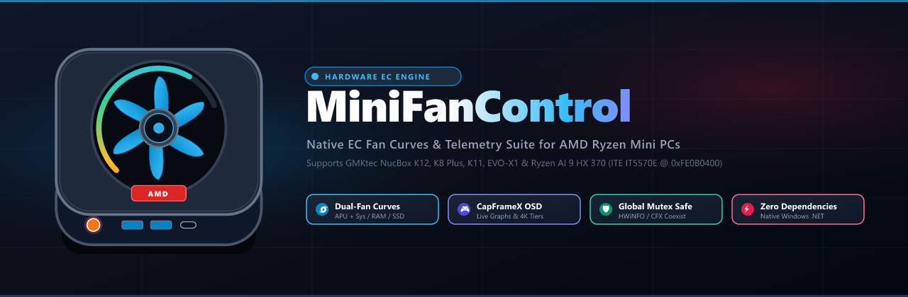

# MiniFanControl — Native EC Fan Control & Thermal Monitor for AMD Ryzen Mini PCs

<p align="center">
  
</p>

[](https://github.com/kaiserc/MiniFanControl/releases)
[-blue.svg)](#-quick-start-windows)
[](#-quick-start-windows)
[-brightgreen.svg)](https://github.com/kaiserc/MiniFanControl/actions)
[](#-capframex--hwinfo-coexistence-globalaccess_ec)
[-success.svg)](#-automated-hardware-safety--curve-test-suite-3434-passing)
[](#-3-high-contrast-themes)

**MiniFanControl** is a lightweight, zero-dependency **Windows (C#/.NET)** Embedded Controller (EC) & Super I/O fan control, custom fan curve, and hardware telemetry monitoring utility built specifically for **AMD Ryzen Mini PCs**—supporting the **KTHIN Ryzen AI 9 HX 370 PRO**, **ADREAMER AriesBox 10 (Ryzen 7 7840HS)**, **TOPC TS-12C**, **GMKtec NucBox K12 (Ryzen 7 H 255 / 8845HS)**, **GMKtec K8 Plus / K11**, and other Zen 4 / Zen 5 Mini PCs with **ITE IT8613E** LPC Super I/O and **ITE IT5570E** EC controllers.

> 📖 **Walkthroughs & Technical References**:  
> - [**Complete User & Hardware Tuning Guide (GUIDE.md)**](GUIDE.md): In-depth walkthrough for fan calibration, motor stall prevention, OSD Studio customization, multi-monitor gaming, and EC register probing.  
> - [**Visual Overview Slide Deck (MiniFanControl-Overview.pptx)**](MiniFanControl-Overview.pptx): 7-slide visual presentation illustrating the architecture, dual-fan curves, OSD Studio, and `Global\Access_EC` mutex.  
> - [**Release Notes & Changelog (RELEASE_NOTES.md)**](RELEASE_NOTES.md): Comprehensive documentation of architectural hardening phases and release milestones.

---

## 💡 Why MiniFanControl?

Standard desktop fan utilities (such as [Fan Control](https://getfancontrol.com/) or motherboard vendor tools) look for desktop Super I/O chips over standard LPC I/O ports. AMD Ryzen Mini PCs are engineered like modern gaming laptops: they rely on a proprietary **ITE IT5570E Embedded Controller (EC)** mapped at `0xFE0B0400`. 

Because desktop utilities cannot detect this controller, Mini PC users were historically limited to fixed BIOS profiles or high noise levels. **MiniFanControl** communicates directly with the Embedded Controller registers via kernel port I/O, providing independent dual-fan curves, live sparkline telemetry, an interactive CapFrameX-style in-game OSD, and taskbar temperature badges.

---

## 🏛️ Project Architecture & Domain Organization

The codebase is organized into cleanly separated domain modules supporting both native Windows builds and SDK-style multi-targeting (.NET Framework 4.8 / .NET 10.0-windows):

```
MiniFanControl/
├── Core/               # Data contracts, hardware profile matching & theme preferences
│   ├── DeviceProfile.cs
│   ├── FanStatus.cs
│   ├── TelemetrySessionStats.cs
│   └── ThemePreference.cs
├── Curves/             # Curve interpolation math & 3-pass automated calibration engine
│   ├── CurvePoint.cs
│   └── FanCalibrationResult.cs
├── Hardware/           # Ring-0 hardware abstraction, mutex synchronization & AMD sensors
│   ├── AmdAdlGpuSensor.cs
│   ├── DemoBackend.cs
│   ├── DriverServiceManager.cs
│   ├── EcBusMutex.cs
│   ├── HardwareBackend.cs
│   └── NativeInpOut.cs
├── Safety/             # Out-of-process crash supervisor daemon & IPC heartbeat watchdog
│   └── WatchdogSupervisor.cs
├── Telemetry/          # RTSS/CapFrameX shared memory reader & transparent OSD HUD
│   ├── CapFrameXOverlayForm.cs
│   └── FpsMonitor.cs
├── Tests/              # 28-point automated hardware safety & regression test suite
│   └── SelfTestSuite.cs
├── Ui/                 # Double-buffered canvases, custom WinForms controls & dialogs
│   ├── AppLogoRenderer.cs
│   ├── DoubleBufferedPanel.cs
│   ├── FanCalibrationDialog.cs
│   ├── FanCurveCanvas.cs
│   ├── LiveTelemetryCanvas.cs
│   ├── MainForm.cs
│   └── NewModeDialog.cs
├── .github/            # GitHub Actions CI/CD workflows & structured issue templates
│   ├── workflows/ci.yml
│   └── ISSUE_TEMPLATE/
├── Program.cs          # CLI dispatcher, headless automation helper & GUI entry point
├── MiniFanControl.csproj # Multi-target SDK project file (.NET 4.8 & .NET 10)
└── build-windows.bat   # Non-destructive atomic compiler script (.old.exe rotation)
```

---

## 💻 Hardware Compatibility Matrix

| System Model / Platform | Processor | Controller / Super I/O | Dual Fans | Control Mode |
| :--- | :--- | :--- | :---: | :--- |
| **KTHIN PRO / EVO-X1 / TOPC TS-12C** | AMD Ryzen AI 9 HX 370 (Radeon 890M) | ITE IT8613E Super I/O + EC | ✅ Yes | **Verified Native (Dual PWM)** |
| **GMKtec NucBox K12** | AMD Ryzen 7 H 255 / 8845HS (Radeon 780M) | ITE IT5570E EC @ `0xFE0B0400` | ✅ Yes | **Verified Native (Dual EC)** |
| **GMKtec NucBox K8 Plus / K11** | AMD Ryzen 7 8845HS / 8945HS | ITE IT5570E EC @ `0xFE0B0400` | ✅ Yes | **Verified Native (Dual EC)** |
| **ADREAMER AriesBox 10 / PB07** | AMD Ryzen 7 7840HS (Radeon 780M) | ITE IT5570E EC @ `0xFE0B0400` | ✅ Yes | **Verified Native (Dual EC)** |
| **Generic Zen 4 / Zen 5 Mini PC** | AMD Ryzen 7000 / 8000 / AI 300 series | ITE IT5570E / Aptio V EC | Auto | **Verified Auto Detection** |
| **Unrecognized / Unsupported System** | Any unverified CPU / Motherboard | Unverified | — | **Safe Read-Only Mode (Writes Locked)** |

> 🛡️ **Fail-Closed Hardware Protection**: If run on an unverified platform, MiniFanControl engages **Safe Read-Only Monitoring Mode**. Telemetry (temperatures, clocks, package power) remains visible, but all hardware write operations are locked to guarantee physical safety. Advanced users can manually select a verified profile under **Tools & Drivers ▾**.

---

## ✨ Key Features

### 🖥️ Redesigned Modern Interface (680×860)
- **Dedicated Hardware Badge Header**: Displays detected product model and APU (e.g., `NucBox K12 • Ryzen 7 8845HS`), active EC profile map, system mutex state, animated glowing fan activity badge, quick **Tools & Drivers ▾** menu, and theme switcher.
- **5 Wide Telemetry Boxes with Real-Time Sparklines**:
  - **CPU Temp**: Reads direct silicon core temperature (Tctl) via official AMD PMLOG (`atiadlxx.dll`) and EC/Super I/O with session peak tracking and zero raw PCI bus collisions.
  - **PCIe & NVMe Bus Safety**: Uses thread-safe AMD kernel driver APIs (`atiadlxx.dll`) for telemetry rather than uncoordinated raw `0xCF8/0xCFC` I/O ports, guaranteeing your NVMe SSD storage controller remains uninterrupted.
  - **iGPU Temp**: Reads integrated Radeon graphics telemetry via AMD Display Library (`atiadlxx.dll`).
  - **APU Power (W)**: Reads true total package power (PPT) directly from AMD silicon telemetry via ADL2 PMLOG (`atiadlxx.dll`). Hovering over the power box reveals the live breakdown: directly measured when hardware rail telemetry is available, or clearly flagged as an algorithmic estimate (`[Estimated]`) when individual rail sensors are unexposed.
  - **Thermal History & CSV Export**: Record up to ~10,000 live telemetry samples with 1-click CSV export under **Tools & Drivers ▾** for benchmarking and temperature analysis.
  - **APU Fan RPM**: Live tachometer speed of the primary APU cooler.
  - **Sys Fan RPM**: Live tachometer speed of the secondary DDR5 RAM and NVMe SSD chassis fan.
  - **Live Sparkline Waveforms**: 118×21 px real-time mini charts inside each box. Click any box to spotlight that metric in the live telemetry graph!

### 📈 Multi-Series Live Telemetry Graph & Custom Curves
- **Combined Live Trend**: Visualizes the last ~180 seconds of CPU temp, iGPU temp, APU power, APU fan RPM, and Sys fan RPM on dual synchronized vertical axes.
- **Interactive Spotlighting**: Click any legend pill or status box to highlight that metric while dimming others.
- **Independent Dual-Fan Curves (`APU Fan` + `Sys Fan`)**: Assign built-in modes (`Balanced`, `Performance`, `Silent`) or custom user-defined curves to each fan independently.
- **Hardware-Safe 2°C Hysteresis**: Cooldown hysteresis buffer eliminates fan speed oscillation during bursty workloads.

### 🎮 CapFrameX-Style OSD Overlay & Dedicated OSD Studio
- **On-Screen Display HUD**: Floating, translucent, always-on-top overlay for gaming and benchmarking.
- **Dedicated OSD Studio Tab**: Configure all overlay parameters directly inside the main window:
  - **4 Live Graph Display Modes**: `✦ Both (Lines + Graph)`, `📈 Combined Graph`, `〰 Mini Sparklines`, or `Text Only`.
  - **4 Scale Tiers**: `100% Std`, `125% Lg`, `150% XL` (ideal for 1440p), and `185% 4K` (large bold readouts for 4K TV couch gaming).
  - **Layout Directions**: `▬ Horiz Bar` or `▮ Vert Stack`.
  - **Adjustable Graph Heights**: 45px Compact, 65px Medium, 95px Large, 130px Extra Large.
  - **Quick Corner Snaps**: One-click snap to `↖ TL`, `↗ TR`, `↙ BL`, or `↘ BR`.
  - **Click-Through Lock (`WS_EX_TRANSPARENT`)**: Mouse clicks pass straight through to full-screen games without stealing focus.
  - **Low-Impact FPS & iGPU Load**: Passively reads in-game FPS from RTSS/CapFrameX shared memory with zero DLL injection and zero anti-cheat risk; automatically displays live Radeon 3D engine load % and clock MHz directly from AMD ADL2.
- **Global Keyboard Hotkeys**: Toggle the overlay (`Ctrl+Alt+F9`) or switch thermal modes (`Ctrl+Alt+F10..F12`) anytime without leaving full-screen games.

### 🛡️ Motor Stall Protection & Automated 3-Pass Calibration
- **Physical Stall Dead-Zone Prevention**: Brushless blower fans stall if driven below their physical spin-up threshold. MiniFanControl's automated calibration engine measures each motor's exact minimum spin-up % (`ApuMinSpinPct` / `SysMinSpinPct`) and enforces a safe minimum PWM floor outside 0% idle.
- **1-Fan vs 2-Fan Auto Detection**: Detects single-fan vs dual-fan Mini PCs during calibration, automatically tailoring the UI and OSD layout.
- **Fail-Safe Exit Handler**: Automatically restores fan control registers to native BIOS EC Auto (`0x00`) on process exit or crash.

### 🔄 Multi-Tool Coexistence (`Global\Access_EC` Mutex)
- Acquires both `Global\Access_EC` and `Global\Access_ISABUS.HTP` mutexes with least-privilege permissions (`Synchronize | Modify`) before every register read or write.
- Allows **MiniFanControl**, **HWiNFO64**, **CapFrameX**, and **LibreHardwareMonitor** to run simultaneously with zero EC bus collisions or register corruption.
- **Fail-Closed Protection**: If mutex creation or acquisition fails, hardware access strictly aborts—never running uncoordinated.
- **Synchronized Hardware Probing**: Super I/O discovery (`0x2E/0x4E`) runs inside synchronized mutex scopes to prevent bus collisions during initial hardware detection.

### ⏱️ Independent Watchdog Supervisor & Register Read-Back Verification
- **Out-of-Process Safety Daemon**: Runs as an independent process (`minifan-helper.exe --watchdog --pid <PID>`).
- **Heartbeat IPC**: Monitors main application health via named events (`Global\MiniFanControl_Heartbeat_<PID>`). Unnamed event fallbacks are strictly rejected fail-closed.
- **Automatic Failsafe Restoration**: If the main process hangs for >3.5s or terminates unexpectedly, the watchdog immediately resets fan registers to BIOS Auto (`0x00`) and verifies the hardware state via register read-back before confirming recovery.
- **Write Verification**: `SetMode`, `SetFan`, `SetAuto`, and `WriteReg` verify register latching and return explicit status codes, ensuring CLI automation never reports false successes.

### 🎨 3 High-Contrast Themes
- **Dark Theme**: High-contrast slate and midnight blue for low-light environments.
- **Light Theme**: Crisp alabaster with bold slate accents.
- **AMD Radeon Theme**: Ruby red / crimson theme inspired by AMD Adrenalin software.
- The OSD overlay can match the active application theme or use classic CapFrameX Cyan/Amber.

---

## 🔒 Kernel Driver Architecture & Security Deep-Dive

### Why `inpoutx64.dll` is Used
Mini PCs communicate with their embedded controller via raw ACPI I/O ports (`0x62/0x66`, `0x6C/0x6E`) and LPC Super I/O ports (`0x2E/0x2F`, `0x4E/0x4F`, `0x0A30–0x0A37`). Because 64-bit Windows prohibits user-mode processes from executing raw x86 `IN`/`OUT` CPU instructions, a kernel-mode driver service (`inpoutx64.sys`) is required.

### Known Industry Risks & Vulnerable Driver Blocklist
`inpoutx64.sys` is an established, widely used open-source driver (historically used by SpeedFan, LCDProc, and various diagnostic utilities). However, because unhardened builds of `inpoutx64.sys` accept arbitrary I/O requests from any local process:
1. **Windows 11 Memory Integrity (HVCI) & Safe Monitoring Fallback**: Microsoft flags `inpoutx64.sys` under Windows 11 **Memory Integrity**. MiniFanControl strongly recommends keeping Memory Integrity **ENABLED**. If Windows 11 blocks `inpoutx64.sys`, MiniFanControl automatically engages **Safe Read-Only Telemetry Monitoring Mode**. All CPU/iGPU temperatures, APU package power, GPU load, clocks, and voltages continue updating natively via AMD's official WHQL-certified driver interface (`atiadlxx.dll` / `amdfendrm.sys`), requiring zero unsigned kernel drivers and zero raw port I/O, while fan writes are safely disabled fail-closed.
2. **Anti-Cheat Conflicts**: Competitive kernel-level anti-cheat software (such as Riot Vanguard, Easy Anti-Cheat, and BattlEye) may flag `inpoutx64.sys` while running.

### How MiniFanControl Hardens Driver Access (Defense-in-Depth)
MiniFanControl wraps all ring-0 driver operations inside a strict user-mode defense layer in [`Hardware/NativeInpOut.cs`](Hardware/NativeInpOut.cs):
- **Strict Fail-Closed Port Whitelist Enforcement**: `IsPortWhitelisted()` strictly permits only documented ACPI EC and Super I/O ports for both reading and writing. Arbitrary unlisted port reads and sensitive ports (e.g., RTC `0x70/0x71`, PIC `0x20/0x21`, PIT `0x40..0x43`, Fast A20/Reset `0x92`, PCI reset `0xCF9`) are blocked fail-closed before touching the driver.
- **Strict Physical Memory Bounds**: `MapPhysToLinSafe()` strictly confines physical memory mapping to the verified IT5570E EC aperture (`0xFE0B0400`, max 4 KB). Attempts to map low memory (<1 MB) or arbitrary system RAM are blocked.
- **Safe Driver Shutdown for Gamers**: Users playing competitive multiplayer titles can immediately unload the driver service without rebooting by running:
  ```powershell
  .\minifan-helper.exe driver-stop
  ```
- **Future Roadmap**: The project is architected so the `NativeInpOut` wrapper can transition to modern, cryptographically signed driver frameworks (such as PawnIO) as certified open-source driver signing becomes accessible.

---

## 🤝 How to Contribute a New Mini PC Hardware Profile

We welcome community hardware profiles for new Zen 4 / Zen 5 Mini PC models! Here is how to create and submit a profile:

1. **Dump EC Registers**:
   Run the diagnostic command to capture your system's 256-byte EC register map, motherboard DMI string, and LPC controller ID:
   ```powershell
   .\minifan-helper.exe dump > my_minipc_dump.txt
   ```
2. **Identify Active Control Registers**:
   Run the live register watcher for 15 seconds while toggling your BIOS performance mode or running a quick CPU stress test:
   ```powershell
   .\minifan-helper.exe watch
   ```
3. **Submit via GitHub**:
   Open a new issue on GitHub using our **[Hardware Compatibility Profile Request]** issue template, attaching the dump report. Our team will verify register offsets and add an active, verified profile to `Core/DeviceProfile.cs`.

---

## 🚀 Quick Start (Windows)

1. **Prerequisite**: Ensure `inpoutx64.dll` is located in the application folder (next to `MiniFanControl.exe`).
2. **First-Time Launch**:
   - Right-click `MiniFanControl.exe` and select **Run as Administrator** once so `inpoutx64.dll` can register its kernel service (`inpoutx64.sys`).
   - Subsequent runs can be launched normally without elevation.
   - *Windows 11 Driver Security Note*: We recommend keeping **Memory Integrity (HVCI) ENABLED**. If Windows Defender blocks `inpoutx64.sys`, MiniFanControl runs in Safe Read-Only Telemetry Mode, reading APU power and temperatures natively via AMD's official driver with full security intact.
3. **Run the App**: Double-click `MiniFanControl.exe` (or run `run-windows.bat`).
4. **Compile from Source**:
   - **Zero Tools Required (.NET 4.8 Framework)**: Double-click `build-windows.bat`. Compiles `MiniFanControl.exe` and `minifan-helper.exe` using the native `.NET Framework` compiler included with Windows 10/11.
   - **Modern .NET 10.0-windows SDK**: Run `dotnet build -c Release` to build modern Windows binaries targeting .NET 10.0-windows and .NET 4.8 multi-target.

---

## 🛠️ CLI Usage (`minifan-helper.exe`)

The included command-line tool provides full scripting, automation, and diagnostic capabilities:

```powershell
# Read live temperatures, fan speeds, and mode as JSON
.\minifan-helper.exe status

# Set EC performance mode (0 = Balanced, 1 = Performance, 2 = Silent)
.\minifan-helper.exe mode 0

# Set manual fan PWM % (1-100 = Manual %, 0 = Return to Auto)
.\minifan-helper.exe fan1 60
.\minifan-helper.exe fan2 45

# Reset both fans and mode to native BIOS automatic control
.\minifan-helper.exe auto

# Run 3-pass automated fan calibration (measures Min Spin %, Max RPM, and detects 1 vs 2 fans)
.\minifan-helper.exe calibrate

# Export 256-byte EC register hex dump & system diagnostic info (for new Mini PCs like HX 370)
.\minifan-helper.exe dump

# Live-watch all 256 EC registers for 15 seconds to identify active control registers
.\minifan-helper.exe watch

# Stop the kernel driver service before launching competitive anti-cheat games
.\minifan-helper.exe driver-stop

# Execute the 28-point automated hardware safety & curve test suite
.\minifan-helper.exe test
```

---

## 🧪 Automated Hardware Safety & Curve Test Suite (34/34 Passing)

The built-in test suite (`minifan-helper.exe test` or automated upon running `build-windows.bat`) rigorously validates safety mechanisms without touching physical registers:

1. **Motor Stall Dead-Zone Protection**: Verifies fan speeds 1%–29% are clamped to safe minimums across 0°C–105°C.
2. **47°C Balanced Curve Stall Regression Test**: Confirms output never dips into the motor stall region at 47°C.
3. **Zero-RPM Idle Segment & Clean Step-Up**: Ensures fans stay at 0% in idle (<45°C) and step up cleanly (≥30%) above 51°C.
4. **Curve Boundary Clamping**: Verifies extreme inputs (15°C -> 0%, 99°C -> 100%) remain strictly bounded.
5. **Tachometer Stall Filter**: Filters tachometer anomalies (8000 and 65535 RPM mapped to 0, valid speeds preserved).
6. **EC Register Bitmask Encoding & Safety Bounds**: Validates 0x80 manual flag and clamped PWM bytes (0x32–0x34).
7. **Custom Curve Config Save/Load Round-Trip**: Verifies serialization and deserialization integrity across profiles.
8. **Multi-Model Ryzen Mini-PC Profile Matching**: Validates profile detection for K12, K8 Plus, HX 370, and AriesBox 10.
9. **Simulation Backend State Machine**: Tests manual fan overrides and failsafe return to BIOS Auto.
10. **Smart EC Candidate Scanner & Dynamic Register Override**: Validates runtime command-line register overrides.
11. **3-Pass Fan Calibration Engine, Date Tracking & Safety Margin**: Validates multi-pass calibration and +2% safety margin.
12. **CapFrameX `Global\Access_EC` Mutex & APU Power Breakdown**: Tests mutex acquisition and PPT breakdown tooltip.
13. **Session Peak/Min/Avg Telemetry & Multi-Series Live Graph History**: Tests telemetry rolling window and statistical tracking.
14. **CapFrameX OSD Multi-Tier Sizing, Live Graphs & Layout Modes**: Validates HUD geometry, scaling tiers, and rendering.
15. **Fail-Closed EcBusMutex Contention & Safe Mutex Isolation**: Verifies fail-closed behavior under cross-process lock contention.
16. **Emergency Thermal Safety Tripwire & Cooldown Hysteresis**: Tests instant 100% full-blast tripwire at ≥90°C and 75°C recovery.
17. **Safe Fail-Closed Hardware Probe Validation**: Verifies probe failures cleanly reject blind port I/O fallback.
18. **Hardware Watchdog Supervisor Lifecycle**: Tests clean shutdown handshake, heartbeat timeout triggers, and process crash recovery.
19. **Driver Security Port Whitelist & Memory Map Safety Bounds**: Validates port whitelist security and physical memory bounds checking.
20. **Unverified Hardware Fail-Closed Read-Only Protection**: Confirms unrecognized hardware platforms are locked to read-only mode.
21. **Session Telemetry CSV Export Integrity & Schema Validation**: Validates 10-column CSV export format, headers, and values.
22. **Missing-Mutex Fail-Closed Enforcement & Lock Security**: Verifies missing EC, ISA, or PCI mutex triggers fail-closed isolation.
23. **Watchdog IPC Named-Event Fail-Closed & Auto Read-Back Verification**: Validates unnamed event fallback rejection and read-back state confirmation.
24. **Parameter Validation & Invalid Fan ID / Mode Rejection**: Verifies out-of-bounds fan IDs (0, 3, -1), PWM percentages (<0, >100), and performance modes (<0, >2) are strictly rejected fail-closed.
25. **Hardware Write Read-Back Verification & Read-Only Safety Protection**: Verifies read-back register mismatches, unverified read-only device profiles, and mutex contention strictly block writes and return `false`.
26. **Strict Fail-Closed Port Whitelist Enforcement**: Verifies unlisted and sensitive port reads and writes (`0x70/0x71`, `0x92`, `0xCF9`, `0x20/0x21`, `0x40..0x43`, `0x61`) are strictly blocked fail-closed.
27. **Centralized Hardware Initializer Safe Default**: Verifies default hardware initialization selects `unknown-safe` (`IsReadOnly = true`), preventing blind K12 writes.
28. **Super I/O Write Read-Back & Separate Restore Paths**: Validates `WriteSuperIoHwReg()` read-back checks, `RestoreNativeEcAuto()`, and `ApplySafeSuperIoFallback()`.
29. **Super I/O Write Failure Detection in `SetFan()`**: Verifies that any failed Super I/O configuration or PWM write is detected and causes `SetFan()` to fail closed.
30. **Thread-Safe Mutex Initialization & Concurrency Safety**: Verifies race-free, multithreaded initialization of `EcBusMutex` under high concurrency.
31. **Watchdog IPC Access Control List (ACL) Hardening**: Verifies named IPC events enforce least-privilege ACLs without inherited `Everyone` (`WorldSid`) permissions.
32. **Native BIOS Auto vs. Safe Super I/O Fallback Distinction**: Validates clear distinction in status and description between native BIOS automatic mode and quiet safe Super I/O fallback.
33. **UI Write-Result Fail-Closed Handling & Independent Emergency Retries**: Verifies UI caches fan speeds ONLY upon confirmed hardware write/read-back verification, preserves prior state on rejected writes, alerts the user visibly, and retries emergency 100% cooling independently every worker cycle.
34. **Watchdog Ready Handshake & Fail-Closed Event Fallback**: Verifies two-way child handshake (`ReadyEvent`) before confirming active supervision, ensures absence of unverified fallbacks, and tests fail-closed timeout detection.

---

## 📊 Embedded Controller (EC) Register Map (`ITE IT5570E @ 0xFE0B0400`)

| Offset | Access | Description | Values / Formula |
|---|---|---|---|
| `0x31` | Read | Active Performance Mode | `0` = Balanced, `1` = Performance, `2` = Silent |
| `0x32` | Write | Set Performance Mode | `0x80` = Balanced, `0x81` = Performance, `0x82` = Silent |
| `0x33` | R/W | **APU Fan (`Fan 1`)** Control | `0x00` = Auto, `0x80 \| pct` = Manual (`1–100%`) |
| `0x34` | R/W | **Sys Fan (`Fan 2`, RAM/NVMe)** Control | `0x00` = Auto, `0x80 \| pct` = Manual (`1–100%`) |
| `0x35–0x36` | Read | **APU Fan (`Fan 1`)** RPM | `(reg[0x35] << 8) \| reg[0x36]` (Max ~3150 RPM; `8000` = motor stopped/idle) |
| `0x37–0x38` | Read | **Sys Fan (`Fan 2`)** RPM | `(reg[0x37] << 8) \| reg[0x38]` (Max ~1940 RPM; `8000` = motor stopped/idle) |
| `0x70` | Read | CPU Temperature | °C |
| `0x71` | Read | dGPU Temperature | `0` on APU models (Radeon iGPU temp is read via AMD `atiadlxx.dll`) |

---

## 🔗 Official Drivers & Manufacturer Resources

Accessible directly inside the app via **`Tools & Drivers ▾`**:

- **GMKtec Official Drivers & Manuals (K12 & NucBox Series)**:  
  https://www.gmktec.com/pages/drivers-and-software
- **GMKtec BIOS & Firmware Updates**:  
  https://www.gmktec.com/pages/firmware-update
- **AMD Software: Adrenalin Edition & Chipset Drivers (Ryzen 7 H 255 / 780M & HX 370 / 890M)**:  
  https://www.amd.com/en/support/download/drivers.html  
  *(Installing the official AMD Adrenalin driver enables native Radeon iGPU temperature & APU power telemetry via `atiadlxx.dll`.)*

---

## ⚠️ Hardware Safety Disclaimer

Direct hardware communication with Embedded Controller physical registers (`0xFE0B0400`) is performed at your own risk. MiniFanControl enforces minimum spinning PWM thresholds, 2°C cooldown hysteresis, safe shutdown handlers, out-of-process watchdog supervision, register read-back verification, and the `Global\Access_EC` mutex to protect your hardware, but users should always ensure adequate airflow when configuring custom fan curves.
