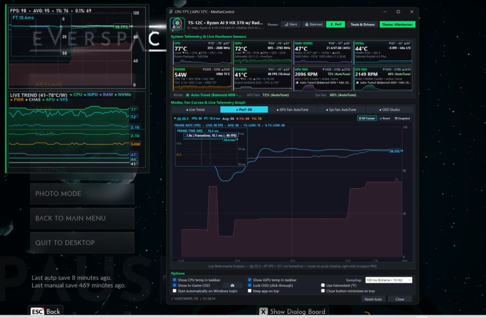

# MiniFanControl — Native EC & Super I/O Fan Control for AMD Ryzen Mini PCs

[](https://github.com/kaiserc/MiniFanControl/stargazers)
[](https://github.com/kaiserc/MiniFanControl/releases)
[](https://github.com/kaiserc/MiniFanControl/releases)
[-brightgreen.svg)](https://github.com/kaiserc/MiniFanControl/actions)
[](Tests/README.md)
[](#-safety--security-architecture)
[](#key-features)
[](LICENSE)
[](https://ko-fi.com/kaiser76)

<p align="center">
  
</p>

<p align="center">
  
</p>

**MiniFanControl** is a lightweight, zero-dependency **Windows (C#/.NET)** fan controller, custom curve editor, and hardware telemetry/OSD suite engineered specifically for **AMD Ryzen Mini PCs** (GMKtec EVO-X1, TOPC TS-12C, GMKtec NucBox K12 / K8 Plus / K11, ADREAMER AriesBox 10, and other Zen 4 / Zen 5 Mini PCs).

Desktop fan utilities typically cannot control Ryzen Mini PCs because they use laptop-style **ITE IT5570E Embedded Controllers** or **ITE IT8613E** LPC Super I/O bridges with dual stacked blowers. MiniFanControl talks natively to both through **HVCI-safe EV-signed [PawnIO](https://pawnio.eu)** while enforcing fail-closed hardware protection.

---

## Quick Start (Windows 10 / 11)

1. **Download** the latest installer or portable ZIP from [**GitHub Releases**](https://github.com/kaiserc/MiniFanControl/releases).
2. **Install [PawnIO](https://pawnio.eu)** (free, EV-signed, **Windows 11 Memory Integrity / HVCI compatible**). MiniFanControl already bundles the SHA256-pinned signed PawnIO modules (`LpcIO.bin`, `LpcACPIEC.bin`, `AMDFamily17.bin`) and includes a guided setup dialog on first launch.
3. **Run `MiniFanControl.exe`** (Run as Administrator for full fan control; launches in **Safe Read-Only Telemetry Mode** automatically if no driver is present).
4. **Calibrate & Auto-Tune (2-Step Setup):**
   - Run **3-Pass Fan Calibration** to discover your blower's exact physical minimum spin-up PWM floor (e.g., `22%` / ~750 RPM instead of a generic `30%` / ~1400 RPM) so fans never stall.
   - Click **`✨ Auto-Tune`** to synthesize a calibrated 5-point curve that automatically adapts to your `Silent` / `Balanced` / `Perf` BIOS TDP mode.
5. **Optional Low-RAM Background Service Mode (`~3.5 MB` RAM / `0%` CPU):** Enable **Tools & Drivers ▾ → Background Service Mode (Low RAM)** (or select it in the installer) to keep curves running silently without keeping the GUI open.

---

## Hardware Compatibility Matrix

| System Model / Platform | Processor | Controller | Dual Fans | Control Mode |
| :--- | :--- | :--- | :---: | :--- |
| **GMKtec EVO-X1 / TOPC TS-12C** | AMD Ryzen AI 9 HX 370 (Radeon 890M) | ITE IT8613E Super I/O + EC | ✅ Yes | **Verified Native (Dual PWM)** |
| **GMKtec NucBox K12** | AMD Ryzen 7 H 255 / 8845HS (Radeon 780M) | ITE IT5570E EC @ `0xFE0B0400` | ✅ Yes | **Verified Native (Dual EC)** |
| **GMKtec NucBox K8 Plus / K11** | AMD Ryzen 7 8845HS / 8945HS | ITE IT5570E EC @ `0xFE0B0400` | ✅ Yes | **Verified Native (Dual EC)** |
| **ADREAMER AriesBox 10 / PB07** | AMD Ryzen 7 7840HS (Radeon 780M) | ITE IT5570E EC @ `0xFE0B0400` | ✅ Yes | **Verified Native (Dual EC)** |
| **Generic Zen 4 / Zen 5 Mini PC** | AMD Ryzen 7000 / 8000 / AI 300 | ITE IT5570E / Aptio V EC | Auto | **Opt-In / EC Diff Scanner** (Read-Only Default) |
| **Unrecognized / Desktop PC** | Any unverified CPU / Motherboard | Unverified | — | **Safe Read-Only Telemetry Mode** |

> Have another Ryzen Mini PC? Run `minifan-helper.exe submit-report` (or **Tools & Drivers ▾ → Submit Hardware Profile**) to generate a PII-redacted probe report and open a [Hardware Profile Request](https://github.com/kaiserc/MiniFanControl/issues/new/choose).

---

## Key Features

- **Independent Dual-Fan Curves & Stall Protection:** Separate curves for **APU Fan** and **Sys Fan** (`max(APU, NVMe, DDR5)` thermal coupling), 4°C asymmetric cooldown hysteresis, 3-pass stall-floor calibration with ≥88°C thermal abort, and 4 protected reference curves (`🔒`).
- **Low-RAM Windows Service & Modern Standby (S0ix) Self-Healing:** `MiniFanControlService` runs headlessly at ~3–5 MB RAM with automatic GUI ↔ Service handoff and live config hot-reload, plus S0ix time-jump detection and `0xFF` Super I/O read-back self-healing after sleep/wake.
- **Deep Native Silicon & Storage Telemetry:** Direct AMD SMN `Tctl/Tdie` (via PawnIO `AMDFamily17.bin`), WHQL AMD ADL2 iGPU/PPT/NPU telemetry, NVIDIA NVML desktop GPU support, dual stacked DDR5 SODIMM temps (`ΔT` & `5600 MT/s`), multi-NVMe SMART temps & R/W throughput, and live Adrenalin 26.x feature pills (`FreeSync`, `FSR`, `AFMF`, `Anti-Lag`, `RSR`, `RIS`).
- **Hook-Free In-Game OSD & Digital Foundry Graphs:** Zero-injection RTSS FPS/frametime reader + native Windows **DXGI/DxgKrnl ETW Display Latency** tracking, `Split (DF)` / `DF Zoom` / `DF Corner` stutter graphs, 4 scale tiers (`100%`–`185% 4K`), horizontal/vertical layouts, and `Ctrl+Alt+F9` hotkeys.
- **6 Built-In Themes:** System Auto, Dark, Light, AMD Radeon Crimson, MSI Afterburner, and **Xmas Edition** (Snow-White / Jet-Black / Crimson with snowflake watermarks).

<p align="center">
  
</p>

---

## Safety & Security Architecture

MiniFanControl is built **fail-closed** from the ground up:

- **PawnIO-First (HVCI-Safe) & SHA256 Pinning:** Priority 0 uses EV-signed **PawnIO** with Authenticode-verified `PawnIOLib.dll` and **SHA256-pinned bytecode modules** (`LpcIO.bin`, `LpcACPIEC.bin`, `AMDFamily17.bin`). Optional manual `inpoutx64.dll` drop-in is SHA256-pinned under a `FileShare.Read` anti-TOCTOU lock; legacy `WinRing0` (CVE-2020-14979) is **hard-gated off by default** (`AllowLegacyWinRing0=1` explicit opt-in required).
- **Strict Port & Physical Memory Allowlists:** Single fail-closed choke point blocks sensitive motherboard/CPU ports (`0x70/71`, `0x92`, `0xCF9`, PIC/PIT) and restricts physical writes exclusively to verified EC MMIO registers.
- **Out-of-Process Watchdog & ≥90°C Tripwire:** Independent `minifan-helper.exe watchdog` monitors heartbeats with monotonic `Stopwatch` timing and restores native BIOS Auto (`0x00`) with read-back verification on crash/hang. A ≥90°C emergency tripwire forces 100% cooling even if the read-only latch is active.
- **HWiNFO64 / CapFrameX Bus Synchronization:** Coordinates via `Global\Access_EC`, `Global\Access_ISABUS.HTP.Method`, `Global\Access_PCI`, and `Global\Access_SMBUS.HTP.Method` with least-privilege `AuthenticatedUserSid` DACLs, surfacing a UI warning banner if `Global\` mutex creation degrades to `Local\`.
- **Verifiable Supply Chain:** GitHub Actions CI builds test-free `.NET 4.8` & `.NET 10.0-windows` binaries, runs **128 automated self-tests** in a dedicated test assembly (`Tests/MiniFanControl.Tests.csproj`), publishes `SHA256SUMS.txt`, and generates GitHub **Build Provenance Attestations** (`actions/attest-build-provenance`). Verify any downloaded artifact locally with the GitHub CLI:
  ```powershell
  gh attestation verify MiniFanControl-Setup-v1.4.0.exe --repo kaiserc/MiniFanControl
  ```

---

## CLI & Power-User Automation (`minifan-helper.exe`)

```powershell
# One-shot JSON telemetry or continuous JSONL stream (for jq / Telegraf / Grafana / Python)
.\minifan-helper.exe status
.\minifan-helper.exe status --stream --interval 1000

# Fan & thermal mode control (clamped to calibrated anti-stall floor unless --force)
.\minifan-helper.exe mode 0                 # 0=Balanced, 1=Performance, 2=Silent
.\minifan-helper.exe fan1 60                # Set APU fan to 60% PWM (0=BIOS Auto)
.\minifan-helper.exe auto                   # Restore BIOS Automatic control

# Background Windows Service & headless daemon
.\minifan-helper.exe service-install        # Install & start MiniFanControlService
.\minifan-helper.exe service-status         # Inspect service state
.\minifan-helper.exe daemon                 # Run foreground headless fan loop

# Diagnostics, hardware reports & 128-point self-test suite
.\minifan-helper.exe dump --json
.\minifan-helper.exe submit-report
.\minifan-helper.exe latency
.\minifan-helper.exe test
```

### Build from Source

- **Zero Tools Required (.NET 4.8):** Run `build-windows.bat` (uses Windows' inbox x64 C# 5 `csc.exe` with `/optimize+ /debug-`; compiles `Tests/` only into `minifan-helper.exe` so `MiniFanControl.exe` stays lean).
- **.NET 10 SDK Multi-Target:** Run `dotnet build -c Release` (note: keep source C# 5 compatible for the inbox `csc.exe` standalone build).

---

## Documentation Index

| Document | Contents |
| :--- | :--- |
| [**User & Hardware Tuning Guide (`GUIDE.md`)**](GUIDE.md) | Setup walkthrough, calibration, OSD Studio, EC register map (`0xFE0B0400`), `minifancontrol.cfg` schema, and FAQ |
| [**128-Point Automated Test Suite (`Tests/README.md`)**](Tests/README.md) | Full catalog of all 128 safety, driver, mutex, calibration, OSD, and service-mode tests |
| [**Hardware Validation Matrix (`HARDWARE_VALIDATION.md`)**](HARDWARE_VALIDATION.md) | 6-profile register matrix, oscilloscope protocols, and IT8613E PWM polarity specs |
| [**Public Roadmap (`ROADMAP.md`)**](ROADMAP.md) | Completed milestones, upcoming release priorities, and planned hardware/distribution work |
| [**Changelog (`CHANGELOG.md`)**](CHANGELOG.md) & [**Release Notes (`RELEASE_NOTES.md`)**](RELEASE_NOTES.md) | Release history and architectural hardening log |
| [**Contributing (`CONTRIBUTING.md`)**](CONTRIBUTING.md) | Safety principles, C# 5 build rules, and submitting new Mini PC profiles |
| [**Visual Overview Deck (`docs/MiniFanControl-Overview.pptx`)**](docs/MiniFanControl-Overview.pptx) | 7-slide architecture and feature presentation |

---

## ⭐ Star History

If MiniFanControl helps keep your Ryzen Mini PC cool and quiet, consider giving the repo a star!

[](https://www.star-history.com/#kaiserc/MiniFanControl&Date)

---

## ☕ Support & Safety Disclaimer

- **Support development on Ko-fi:** [ko-fi.com/kaiser76](https://ko-fi.com/kaiser76)
- **Disclaimer:** Direct Embedded Controller and Super I/O register control is performed at your own risk. MiniFanControl enforces fail-closed profiles, stall-floor clamping, 4°C cooldown hysteresis, out-of-process watchdog supervision, read-back verification, and `Global\Access_EC` bus locking, but always verify adequate airflow when tuning custom curves.
